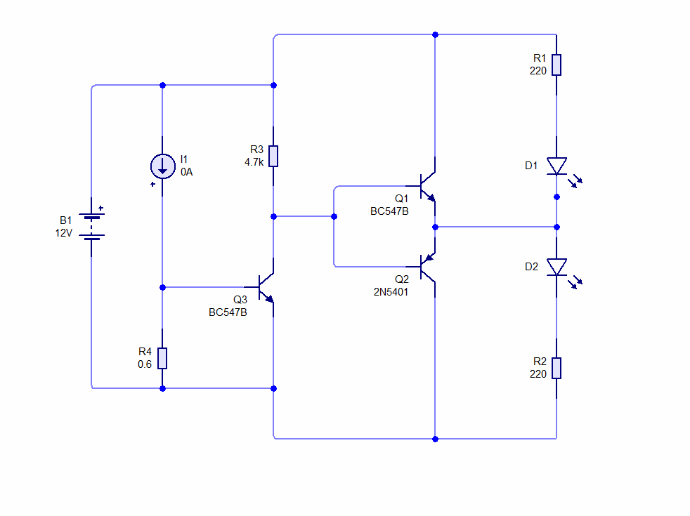

# Ep8 – Various Transistor Circuits and Circuit Design for a Light Bulb Factory

**Course:** Professional Electronic Design Course – Level 1 (Simple Electronic Design)
**Source:** Waleed Issa Academy – [Various transistor circuits and circuit design for a light bulb factory](https://www.youtube.com/watch?v=qVGQhxMi4MI&list=PLww54WQ2wa5qVh1p8iPi7HspX7N9hbvbc&index=146) (video in Arabic)
**Tool:** Circuit Wizard

> This is my own English summary of the episode, written for study purposes. All credit for the content goes to Waleed Issa Academy.

---

## Overview

The episode introduces two small "building block" circuits and then combines them into one design:

1. **Push-pull (complementary) transistor pair** – chooses which of two LEDs lights, based on a high or low input.
2. **Current-sensing transistor** – turns a transistor on only when the current through a small resistor exceeds a set value.
3. **Design task: a light bulb tester** – a factory makes 12 V bulbs that should draw **1 A or less**. Build the cheapest circuit that shows a **red** LED if a bulb draws more than 1 A and a **green** LED otherwise.

**Prerequisite:** how NPN and PNP transistors switch on and off.

---

## 1. Push-Pull Transistor Pair

### The problem

Two LEDs in series with resistors across the supply always light together. There is no way to light only one of them.

### The circuit

An NPN transistor (Q1) and a PNP transistor (Q2) are stacked between the supply and ground:

- Q1 (NPN): collector to $+V$, emitter to the middle node.
- Q2 (PNP): emitter to the middle node, collector to ground.
- Both **bases are tied together** and driven by one input.
- The middle node connects to the point between the two LEDs:
  - $+V \rightarrow R_1 \rightarrow D_1 \rightarrow$ middle node
  - middle node $\rightarrow D_2 \rightarrow R_2 \rightarrow$ ground

### How it works

The idea is to **steer the current** by shorting one LED:

| Input | Q1 (NPN) | Q2 (PNP) | Middle node | Result |
|---|---|---|---|---|
| High ($\approx V_{CC}$) | ON | OFF | pulled up to $\approx V_{CC} - 0.7\ \text{V}$ | D1 is shorted (same voltage on both sides), **D2 lights** |
| Low ($0\ \text{V}$) | OFF | ON | pulled down to $\approx 0.7\ \text{V}$ | D2 is shorted, **D1 lights** |

- An NPN turns on when its base is about $0.7\ \text{V}$ **above** its emitter.
- A PNP turns on when its base is about $0.7\ \text{V}$ **below** its emitter.

Because one input turns one transistor on and the other off, **exactly one LED is lit at a time**. Two NPNs would not work: they would turn on and off together.

---

## 2. Current-Sensing Transistor

### The idea

Instead of feeding the base from a battery or a signal, put a small **sense resistor** $R_s$ between base and emitter, in the path of the load current. By Ohm's law:

$$V_{BE} = I_{load} \cdot R_s$$

The transistor turns on once $V_{BE} \approx 0.6\text{–}0.7\ \text{V}$, so the **trip current** is:

$$I_{trip} \approx \frac{0.6\text{–}0.7\ \text{V}}{R_s}$$

Examples:

- $R_s = 1\ \Omega \Rightarrow I_{trip} \approx 0.7\ \text{A}$
- $R_s = 0.6\ \Omega \Rightarrow I_{trip} \approx 1\text{–}1.1\ \text{A}$

### Simulation in the video ($R_s = 0.6\ \Omega$)

| Load current | $V_{BE} = I \cdot 0.6\ \Omega$ | LED |
|---|---|---|
| 0.5 A | 0.30 V | OFF |
| 1.0 A | 0.60 V | OFF (not quite enough) |
| 1.1 A | 0.66 V | ON |
| 2.0 A | 1.2 V (clamped by the B–E junction) | ON, brighter |

**Takeaway:** a transistor with a resistor between base and emitter is a **current sensor**. It "decides" whether the current is above a chosen limit.

---

## 3. Design Task: Light Bulb Tester

### Combining the blocks

- The current sensor (Q3 + $R_s$) carries the bulb's current.
- Its LED is replaced by a **pull-up resistor $R_3 = 4.7\ \text{k}\Omega$** from $+12\ \text{V}$ to Q3's collector.
- Q3's collector is the **output**, and it drives the tied bases of the push-pull pair.

| Bulb current | Q3 | Output (bases) | Push-pull | LED |
|---|---|---|---|---|
| $> 1\ \text{A}$ | ON | pulled to ground | Q2 (PNP) ON | **Red** (D1) |
| $\le 1\ \text{A}$ | OFF | pulled high through $R_3$ | Q1 (NPN) ON | **Green** (D2) |

### Component values

| Part | Value |
|---|---|
| Supply | 12 V |
| Q1, Q3 | BC547B (NPN) |
| Q2 | 2N5401 (PNP) |
| $R_s$ (R4) | 0.6 Ω (simulation) / 3 × 1.5 Ω in parallel = 0.5 Ω (hardware) |
| $R_3$ (pull-up) | 4.7 kΩ |
| $R_1$, $R_2$ (LED resistors) | 220 Ω |
| D1 / D2 | Red / Green LED |

### Calibrating the pull-up $R_3$

$R_3$ sets how hard Q3 must conduct to pull the output low, so it acts like a sensitivity adjustment:

- **10 kΩ (too high):** at 0.9 A, Q3 is only partly on, yet that is enough to pull the output low. The red LED glows dimly when it shouldn't.
- **1 kΩ (too low):** at 1 A, the red LED does not light. At 1.1 A, red and green light together because Q3 cannot fully pull the output down.
- **4.7 kΩ (middle):** clean switching around 1 A. Q3 saturates fully above the limit and stays off below it.

In simulation at exactly 1 A both LEDs light a little. This is the transition zone between the two states.

### Hardware build

A 0.6 Ω resistor wasn't available, so three **1.5 Ω** resistors were connected in parallel:

$$R_s = \frac{1.5\ \Omega}{3} = 0.5\ \Omega \qquad V_{BE} = 1\ \text{A} \times 0.5\ \Omega = 0.5\ \text{V}$$

According to the BC547 datasheet, it can start conducting around 0.5 V, so the trip point lands near 1 A in practice.

**Power check at 1 A** (each resistor carries $1/3$ of the current):

$$P = I^2 R = (0.333\ \text{A})^2 \times 1.5\ \Omega \approx 0.167\ \text{W} = 167\ \text{mW}$$

That is below the **250 mW (¼ W)** rating, so the resistors are safe at 1 A.

### Measured results (from the video)

| Test | Current drawn | LED |
|---|---|---|
| No bulb | ≈ 0.038 A (circuit only) | Green |
| Bulb 1 | ≈ 1.6 A | **Red** ✔ |
| Bulb 2 | ≈ 0.19 A | **Green** ✔ |

The circuit correctly classified both bulbs.

---

## My Circuit Wizard Simulations

### Figure 1 – Push-pull pair

- **Setup:** 9 V battery (the video uses 12 V), SW1 drives the tied bases of Q1 (NPN) and Q2 (PNP), $R_1 = R_2 = 220\ \Omega$.
- **Shown:** the input is switched to ground, so Q2 is on and pulls the middle node low. **D1 (top) lights** and D2 is off.
- **Expected vs. simulated:** matches the table in Section 1. With a low input, the top LED lights.
- **Estimated LED current** (assuming ≈ 2 V LED drop):

$$I_{LED} \approx \frac{9 - 0.7 - 2}{220} \approx 29\ \text{mA}$$

### Figure 2 – Current sensor

- **Setup:** 12 V, current source $I_1 = 1.1\ \text{A}$ as the load, $R_1 = 0.6\ \Omega$ between base and emitter, red LED with 220 Ω on the collector.
- **Expected:** $V_{BE} = 1.1 \times 0.6 = 0.66\ \text{V}$, which is just enough to turn Q1 on.
- **Simulated:** D1 lights ✔. This matches the video.

### Figure 3 – Complete bulb tester

- **Setup:** full design. $I_1$ = load, $R_4 = 0.6\ \Omega$, Q3 BC547B, $R_3 = 4.7\ \text{k}\Omega$, Q1 BC547B, Q2 2N5401, $R_1 = R_2 = 220\ \Omega$.
- **Shown:** $I_1 = 0\ \text{A}$. Q3 is off, so the output is pulled high and **D2 (green)** should light.
- **Next step:** sweep $I_1$ through 0.5 A, 0.9 A, 1.0 A, 1.1 A and 1.5 A and record which LED lights.

---

## What I Learned

- Complex designs are built from **small blocks**. Learn each block, then connect an output of one to the input of the next.
- A **complementary NPN/PNP pair with tied bases** lets one signal select between two loads.
- A **resistor between base and emitter** turns a transistor into a current-threshold detector: $I_{trip} \approx 0.7\ \text{V} / R_s$.
- A **pull-up resistor** converts "transistor on/off" into a clean high/low output for the next stage, and its value affects sensitivity.
- Always check **resistor power** ($P = I^2R$) when large currents flow through sense resistors.

### My notes / things to watch

- **Sense resistor power at higher currents:** the 1.6 A bulb puts about 0.53 A through each 1.5 Ω resistor:

  $$P \approx (0.533)^2 \times 1.5 \approx 0.43\ \text{W}$$

  That is above the ¼ W rating. For a quick test this is fine, but for repeated use I'd choose **½ W or 1 W** resistors.
- **Trip point tolerance:** with 0.5 Ω and $V_{BE}$ between 0.5 and 0.7 V, the real trip point is roughly **1.0–1.4 A**. The hardware test used 0.19 A and 1.6 A bulbs, which are far from the limit. A bulb at about 1.1 A would be a better test of accuracy.
- **LED current at 12 V:** $(12 - 0.7 - 2) / 220\ \Omega \approx 42\ \text{mA}$, which is above the typical 20 mA LED rating. A **470 Ω** resistor would give about 20 mA.
- $V_{BE}$ depends on temperature, so the trip point drifts slightly as the transistor warms.
