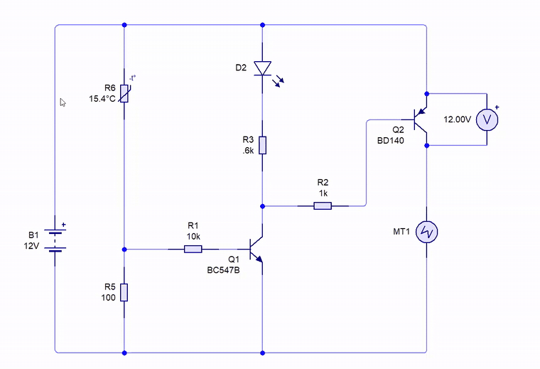

# Ep11 – Designing a Car-Factory Panel to Control the Cooling Fan

**Course:** Professional Electronic Design Course – Level 1 (Simple Electronic Design)
**Source:** Waleed Issa Academy – [تصميم لوحة لمصنع سيارات للتحكم بمروحة التبريد (Designing a car-factory panel to control the cooling fan)](https://www.youtube.com/watch?v=MS73p18R1EE&list=PLww54WQ2wa5qVh1p8iPi7HspX7N9hbvbc&index=149) (video in Arabic)
**Tool:** Circuit Wizard

> This is my own English summary of the episode, written for study purposes. All credit for the content goes to Waleed Issa Academy.

---

## Overview

**The task:** a car factory wants a small circuit that switches the engine's **cooling fan** on when the temperature rises and off when it falls. One rule applies: in a car, every load must have its negative side **permanently connected to the battery negative (the chassis/body)**.

To get there, the episode answers three questions:

1. Why do we want a switching transistor to be **saturated**? (Answer: heat.)
2. Why can't an NPN transistor placed **above** a grounded load saturate?
3. How does the **driver transistor** circuit (a small NPN driving a PNP) solve this?

The design then adds a **thermistor** in a voltage divider to make the switch automatic, and the instructor builds and tests it with a real fan and a soldering iron.

**Prerequisites:** how NPN and PNP transistors switch, the inverting transistor pair from [ep10](../ep10-battery-charge-status-monitor/), and the voltage divider.

---

## 1. Why Saturation Matters: Power Loss and Heat

A transistor is **saturated** when it is switched fully on and the voltage between collector and emitter is close to zero: a few tens to a few hundred millivolts.

The power a transistor wastes is the voltage across it times the current through it:

$$P_{loss} = V_{CE} \times I_C$$

That power doesn't disappear. It turns into **heat** inside the transistor.

| State | $V_{CE}$ | $P_{loss}$ | Result |
|---|---|---|---|
| Saturated | ≈ 0 V | ≈ 0 W | Stays cool |
| Partly on | a few volts | $V_{CE} \times I_C$ (can be watts) | Heats up |

With a small LED load this barely matters, but with a motor, pump or lamp drawing 1–3 A, an unsaturated transistor gets hot quickly. **Saturating the transistor is how we keep it cool**, and it also lets the full supply voltage reach the load.

---

## 2. The Car Rule: Loads Are Always Grounded

In car manufacturing, every electrical part (headlights, indicator lamps, pumps, wiper motor, fans) has one terminal **always tied to the battery negative**, which mechanics call the **chassis** or **body**. You never switch the negative side.

To turn a load on, you switch its **positive** side with a transistor, a relay, etc. This is called **high-side switching**.

The load also needs the **full 12 V**. A 12 V pump that only gets 7 V won't work properly.

---

## 3. The Problem: NPN Above a Grounded Load

Start from the inverting pair of ep10, where the load (LED) sits on the collector of the output NPN, *above* the transistor (low-side switching). Simulated, that transistor saturates nicely: $V_{CE} \approx 111\ \text{mV}$.

Now follow the car rule: move the load **below** the NPN (load to ground, NPN between +12 V and the load). The LED still turns on and off, so the circuit "works", but the voltages tell a different story:

| Load | Base resistors | Voltage reaching the load (of 12 V) |
|---|---|---|
| LED | original | ≈ 7.8 V (≈ 4–5 V lost in the transistor) |
| LED | 10 kΩ | ≈ 9.6 V |
| LED | 1 kΩ | ≈ 11 V |
| LED | 100 Ω | ≈ 11.2 V |
| Motor (≈ 1.2 A) | original | ≈ 7 V |
| Motor (≈ 1.2 A) | reduced to ~10 Ω | ≈ 9 V (≈ 2 V still lost) |

**Why:** in this position the NPN acts as an **emitter follower**. Its emitter (the load voltage) can only rise to about 0.7 V *below* its base. As the load voltage rises, $V_{BE}$ shrinks and the transistor throttles itself. The base can't be pushed above the 12 V supply, so the load never gets the full 12 V.

Pumping more base current (smaller base resistors) helps a little with an LED, but with a 1.2 A motor about 2 V stays across the transistor:

$$P_{loss} \approx 2\ \text{V} \times 1.2\ \text{A} \approx 2.4\ \text{W}$$

That's a lot of heat for a transistor, and the tiny base resistors now carry large currents and heat up too.

---

## 4. Reading Heat from a Datasheet

How hot will the transistor get? Datasheets sometimes help:

| Transistor | Package | Max power $P_{tot}$ | Derating |
|---|---|---|---|
| TIP31 / TIP32 | TO-220 (metal tab) | 40 W | 0.32 W/°C |
| BC547 | TO-92 (plastic) | 500 mW | not given |
| 2N2222 | TO-18 (metal can) | — | 2.28 mW/°C |

The instructor reads the **derating factor** as "how much power raises the temperature by 1 °C", starting from room temperature (25 °C). For the TIP31, $1/0.32 \approx 3.1\ ^\circ\text{C/W}$, so wasting 1 W raises it about 3 °C (25 → ≈ 28 °C).

> **My note:** strictly, $1/\text{derating}$ is the junction-to-case thermal resistance ($R_{\theta JC}$). Without a heatsink, the real rise is much larger. Either way, the point stands: it is only an **estimate**.

When no thermal data is given (BC547), just make sure $V_{CE} \times I_C$ stays well under the maximum power. The safest approach: **make sure the transistor saturates** so the loss is as small as possible.

---

## 5. The Solution: The Driver Transistor Circuit

For a grounded load, use a **PNP** on the high side: emitter to +12 V, collector to the load. A PNP saturates when its base is pulled to **0 V**, and pulling a base to ground is easy. A small NPN can do it.

**Connections:**

- **Load:** PNP collector → load → ground (chassis)
- **PNP:** emitter to +12 V; a resistor from its base to +12 V (keeps it off)
- **Driver NPN:** collector → resistor → PNP base; emitter to ground
- **Input:** switch / sensor → base resistor → NPN base

**How it works:**

- **Switch open:** the NPN is off, the PNP base is pulled up to 12 V → $V_{BE} = 0$ → **PNP off, load off**.
- **Switch closed:** the NPN saturates (simulated collector ≈ 2.5 mV), pulling the PNP base toward 0 V → **PNP saturates, load gets ≈ 12 V**.

Unlike the ep10 pair, this one is **not inverting**: both transistors turn on and off together.

**Simulated results (from the video):**

| Load | Base resistors | Load voltage |
|---|---|---|
| LED | 10 kΩ / 10 kΩ | ≈ 11.6 V |
| Lamp + motor | 10 kΩ / 10 kΩ | ≈ 11 V |
| Lamp + motor (≈ 1.5 A) | reduced to 1 kΩ | ≈ 11.2 V |

The PNP passes almost the full 12 V even at 1.5 A, with ordinary resistor values.

### Adding an indicator LED

Put an **LED + resistor** in the PNP's base path (between the PNP base and the NPN collector). When the NPN switches on, the PNP base current flows through the LED, so it lights exactly when the load is on. It's a free "fan is running" signal, and the load still gets ≈ 11.25 V.

### A second form (not for grounded loads)

The roles can be swapped: a **PNP drives an NPN**, with the load on the NPN's collector (above the NPN). The PNP turns on when its input is pulled to **ground**, then sends current into the NPN base.

This is useful when:

- the control signal is **ground-active** (a switch or sensor that connects to 0 V instead of to +12 V), and
- you want to push the output NPN into saturation **quickly and firmly**.

It doesn't follow the car rule, because the load isn't grounded.

---

## 6. Design Task: Automatic Cooling Fan

**Brief:** design a circuit that turns a car's 12 V cooling fan on when it gets hot and off when it cools down. The fan must stay connected to the battery negative.

**Plan:**

- The fan is grounded → a **PNP high-side switch**.
- To saturate the PNP → the **driver-transistor** circuit (NPN driving PNP).
- Replace the manual switch with a **temperature sensor** that makes the decision.

### The sensor: an NTC thermistor in a voltage divider

A **thermistor** is a resistor whose value changes with temperature. This one is **NTC**: hotter → lower resistance. The instructor measured his:

| Condition | Resistance |
|---|---|
| Room temperature (≈ 25 °C) | ≈ 7.5–8 kΩ |
| Heated | drops toward ≈ 100 Ω |

A resistance change alone can't switch a transistor, so the thermistor goes in a **voltage divider**:

- **Top ($R_1$):** thermistor, from +12 V to the midpoint
- **Bottom ($R_2$):** fixed resistor, from the midpoint to ground
- **Midpoint** → NPN base (the driver)

As the thermistor heats up, $R_1$ falls, so a larger share of the 12 V appears across $R_2$, and the NPN base voltage rises until it turns on.

### Calculating $R_2$

An NPN needs about 0.6–0.7 V on its base in theory, but in practice it can start conducting near 0.5 V. To be sure the fan stays **off** at room temperature, aim for **0.4 V** when the thermistor is 8 kΩ.

$$V_{out} = V_{in} \cdot \frac{R_2}{R_1 + R_2}$$

$$0.4 = 12 \cdot \frac{R_2}{8\ \text{k}\Omega + R_2} \quad\Rightarrow\quad R_2 = \frac{0.4 \times 8\ \text{k}\Omega}{12 - 0.4} \approx 276\ \Omega$$

(The video gives ≈ 273 Ω.) This is roughly the *boundary* value. Since the thermistor may sit at 7.5 kΩ instead of 8 kΩ at room temperature, the instructor picks a lower, safer value: **$R_2$ = 100 Ω**. The important lesson: the answer is in the **hundreds of ohms**, not 10, 20 or 30 kΩ.

> **My check:** with $R_2$ = 100 Ω, the base sees $12 \times \frac{100}{8100} \approx 0.15\ \text{V}$ at room temperature (well off). It reaches ≈ 0.6 V when $R_1$ falls to about $\frac{12 \times 100}{0.6} - 100 \approx 1.9\ \text{k}\Omega$, so the fan should switch on once the thermistor drops below ≈ 2 kΩ.

### Component values (hardware build)

| Part | Value |
|---|---|
| Supply | 12 V |
| Fan | 12 V DC cooling fan (to ground) |
| High-side PNP | **BD140** (chosen for its high current rating) |
| Driver NPN | **BC547B** |
| Thermistor $R_1$ | NTC, ≈ 8 kΩ at 25 °C |
| $R_2$ (divider bottom) | **100 Ω** (≈ 276 Ω calculated as the boundary) |
| Other resistors | 1 kΩ, plus a few-kΩ resistor in the driver stage |
| Indicator | Red LED (lights with the fan) |

### Results

**Simulation (from the video):** at low temperature the divider gives about 0.5 V, so neither the fan nor the LED is on. When the temperature is raised, the divider voltage rises to about 2 V, and the LED and fan switch on.

**Hardware test:** the instructor brings a soldering iron slowly toward the thermistor. Once it is hot enough, the **red LED and the fan turn on**. When the iron is moved away and the sensor cools, they **turn off**. When the fan is pointed straight at the sensor, it switches on and then quickly off again, because it cools its own sensor.

In a car, the sensor would sit on the engine body, so the fan runs only while the engine is above a set temperature.

---

## My Circuit Wizard Simulations

All files are in [`media/`](./media/). The GIFs play on this page (1.5× speed, cropped to the circuit). Click the MP4 links for the full recordings. In every circuit the supply is 12 V and the voltmeter sits across the output transistor's collector and emitter, so it shows the voltage **wasted** in the transistor. The closer to 0 V, the better.

### 1. NPN above a grounded load (inverting pair)

*SW1 is toggled. With SW1 open, Q2 (NPN) lights the red LED D1 below it but keeps 4.20 V across itself. With SW1 closed, Q1 takes over, the green LED D2 lights and Q2 is off (11.99 V). Watch the voltmeter: it never gets near 0 V while D1 is lit.* · [MP4](media/ep11-sim-npn-above-load-inverting-pair.mp4)

📁 Circuit file: [ep11-npn-above-load.cwz](./ep11-npn-above-load.cwz) (one file with both versions: green LED pull-up and 10 kΩ pull-up)

- **Setup:** Q1 base ← R1 = 10 kΩ ← SW1; Q1 collector ← R3 = 220 Ω + green D2 ← +12 V; R4 = 46 kΩ from Q1 collector to Q2 base; Q2 collector to +12 V, emitter → red D1 → R2 = 220 Ω → ground.

### 2. Same circuit, 10 kΩ pull-up instead of the green LED

*Q1's collector load is now a plain R7 = 10 kΩ. When the red LED D3 is on, Q4 still drops 4.12 V. Removing the green LED barely changed anything.* · [MP4](media/ep11-sim-npn-above-load-10k-pullup.mp4)

📁 Circuit file: [ep11-npn-above-load.cwz](./ep11-npn-above-load.cwz) (one file with both versions: green LED pull-up and 10 kΩ pull-up)

| Circuit | $V_{CE}$ of output NPN (load on) | Voltage left for the load |
|---|---|---|
| Green LED + 220 Ω pull-up | 4.20 V | 7.80 V |
| 10 kΩ pull-up | 4.12 V | 7.88 V |
| Video (same idea) | — | ≈ 7.8 V |

**Expected vs. simulated:** my 7.8 V matches the video exactly ✔. Both versions waste about **4.1–4.2 V**, so the pull-up isn't the problem. The 46 kΩ base resistor is: the NPN is an emitter follower, and its emitter can only sit about 0.7 V below its base. The base is fed through 46 kΩ, so it never gets close to 12 V. With a red LED and 220 Ω this is roughly $(12 - 4.2 - 2)/220 \approx 26\ \text{mA}$, so the transistor wastes about $4.2\ \text{V} \times 26\ \text{mA} \approx 0.11\ \text{W}$. Fine for an LED, but at 1 A it would be over 4 W.

### 3. Driver transistor with an LED load (BC547B → TIP127)

*SW2 is toggled. When it closes, Q3 (BC547B) pulls the base of Q4 (TIP127, PNP) low, and the red LED D3 below Q4 lights. Watch the voltmeter fall from 11.89 V to just 412 mV.* · [MP4](media/ep11-sim-driver-tip127-led.mp4)

📁 Circuit file: [ep11-driver-tip127.cwz](./ep11-driver-tip127.cwz) (one file with both versions: LED load and motor load)

- **Setup:** SW2 → R5 = 10 kΩ → Q3 base; R8 = 10 kΩ from +12 V to Q3 collector; R7 = 10 kΩ from Q3 collector to Q4 base; Q4 emitter to +12 V, collector → red D3 → R4 = 220 Ω → ground.

### 4. Driver transistor with a motor (BC547B → TIP127)

*SW1 is toggled with a DC motor MT2 as the grounded load. The green LED D1 in Q1's collector is the "motor running" indicator. Watch the voltmeter: 12.00 V when off, 489–577 mV while the motor spins.* · [MP4](media/ep11-sim-driver-tip127-motor.mp4)

📁 Circuit file: [ep11-driver-tip127.cwz](./ep11-driver-tip127.cwz) (one file with both versions: LED load and motor load)

- **Setup:** SW1 → R1 = 10 kΩ → Q1 (BC547B) base; green D1 + R3 = 220 Ω from +12 V to Q1 collector; R2 = 500 Ω from Q1 collector to Q2 (TIP127) base; Q2 emitter to +12 V, collector → MT2 → ground.

| Circuit (load on) | Output transistor | $V_{CE}$ | Load gets |
|---|---|---|---|
| NPN above load (sim 1) | NPN | 4.20 V | 7.80 V |
| Driver, LED load (sim 3) | TIP127 | 0.41 V | 11.59 V |
| Driver, motor load (sim 4) | TIP127 | 0.49–0.58 V | ≈ 11.4–11.5 V |
| Video, LED / lamp + motor | PNP | — | 11.58 V / ≈ 11 V |

**Expected vs. simulated:** the driver circuit fixes the problem ✔. The wasted voltage drops about **10×**, from 4.2 V to 0.41 V, even though the LED now draws more current (≈ 44 mA vs 26 mA). The transistor's power drops from ≈ 0.11 W to $0.41\ \text{V} \times 44\ \text{mA} \approx 18\ \text{mW}$.

> **Note:** I used a **TIP127**, which is a PNP *Darlington* (two transistors in one package). A Darlington can't saturate as deeply as a single transistor, so 0.4–0.6 V is about as low as it goes. With a single PNP like the BD140 used in the video, $V_{CE}$ could be lower.

### 5. Second form: PNP drives NPN, ground-active switch

*Here SW1 connects Q2's base to **ground** instead of to +12 V. When it closes, Q2 (PNP) turns on, lights D1 and feeds Q1's base, which lights D2 on Q1's collector. Watch Q1's voltmeter: 54.85 mV, fully saturated.* · [MP4](media/ep11-sim-pnp-drives-npn-ground-input.mp4)

📁 Circuit file: [ep11-pnp-drives-npn.cwz](./ep11-pnp-drives-npn.cwz)

- **Setup:** Q2 emitter to +12 V, base → R3 = 500 Ω → SW1 → ground; Q2 collector → green D1 → R1 = 100 Ω → ground, and → R2 = 10 kΩ → Q1 base; Q1 collector ← R4 = 220 Ω + green D2 ← +12 V; Q1 emitter to ground.

**Expected vs. simulated:** works exactly as described in the video ✔. A switch to **ground** turns everything on, and the output NPN saturates hard (55 mV), because Q2 hands it almost the full 12 V through R2. The load (D2) sits above Q1, so this form doesn't follow the car rule. It's for circuits where the input signal is ground-active.

> **Side note:** R1 = 100 Ω is quite low for an LED on 12 V. Roughly $(12 - 2)/100 \approx 0.1\ \text{A}$ would flow, far above a normal LED's ≈ 20 mA. In a real build I'd use ≈ 470 Ω–1 kΩ there.

### 6. The cooling-fan controller (thermistor → BC547B → BD140 → fan)

*The thermistor R6 is heated step by step from 15 °C to 80 °C with its slider. Nothing happens until ≈ 65 °C, then the voltage across Q2 starts to fall, the red LED D2 lights and the fan MT1 spins. Watch the voltmeter: at 80 °C it still reads 9.05 V, so most of the 12 V is lost in Q2.* · [MP4](media/ep11-sim-thermistor-fan-controller.mp4)

📁 Circuit file: [ep11-thermistor-fan-controller.cwz](./ep11-thermistor-fan-controller.cwz)

- **Setup:** R6 = NTC thermistor (10 kΩ at 25 °C) from +12 V to the divider midpoint; R5 = 100 Ω from midpoint to ground; R1 = 10 kΩ from midpoint to Q1 (BC547B) base; red D2 + R3 = 600 Ω from +12 V to Q1 collector; R2 = 1 kΩ from Q1 collector to Q2 (BD140) base; Q2 emitter to +12 V, collector → fan MT1 → ground.

| Temperature | Thermistor R6 | Divider voltage* | $V_{CE}$ of Q2 | Fan / LED |
|---|---|---|---|---|
| 15.4 °C | 15.64 kΩ | 0.08 V | 12.00 V | Off |
| 33.8 °C | 6.79 kΩ | 0.17 V | 12.00 V | Off |
| 43.1 °C | 4.64 kΩ | 0.25 V | 12.00 V | Off |
| 56.9 °C | 2.73 kΩ | 0.42 V | 12.00 V | Off |
| 64.6 °C | 2.07 kΩ | 0.55 V | 11.93 V | Just starting |
| 70.8 °C | — | — | 11.41 V | Starting |
| 75.4 °C | 1.44 kΩ | 0.78 V | 9.42 V | On (partly) |
| 76.9 °C | 1.37 kΩ | 0.82 V | 9.65 V | On (partly) |
| 80 °C | 1.24 kΩ | 0.90 V | **9.05 V** | On (partly) |

\* Calculated by me: $V = 12 \times \frac{100}{R_6 + 100}$, ignoring the small current drawn by Q1's base.

**Expected vs. simulated:**

- **Switch-on point ✔.** My estimate was "the fan turns on when the thermistor drops below ≈ 2 kΩ". In the simulation it starts at **2.07 kΩ (≈ 65 °C)**. Circuit Wizard's thermistor is 10 kΩ at 25 °C (not 8 kΩ like the instructor's), so at room temperature the divider gives only ≈ 0.12 V, safely off.
- **Saturation ✘.** This is the surprise. Even at 80 °C the BD140 still drops **9.05 V**, so the fan gets only ≈ 3 V. That's the very problem this episode is about, and the driver circuit doesn't solve it here. (The 9.42 → 9.65 V wobble between 75 °C and 77 °C is probably the motor still settling after each step.)
- **My explanation:** the weak link is **Q1's base**. The divider's output is under 1 V and it reaches Q1 through R1 = 10 kΩ, so Q1 gets only about $\frac{0.9 - 0.65}{10\ \text{k}\Omega} \approx 25\ \mu\text{A}$. Even with $\beta \approx 300$, Q1 can sink only ≈ 7 mA. The LED branch alone wants $\frac{12 - 2}{600} \approx 17\ \text{mA}$, so Q1 never saturates and Q2's base is never pulled firmly to 0 V. In sims 3 and 4, Q1 was fed from the full 12 V through 10 kΩ (≈ 1.1 mA), which is why those worked.
- In the video, the divider seems to feed the driver more directly (the instructor mentions only a 1 kΩ in that area), so his hardware likely didn't hit this.

---

## What I Learned

- **Saturation = cool transistor.** $P = V_{CE} \times I_C$: with $V_{CE} \approx 0$ almost no power becomes heat.
- In cars, loads are **always grounded to the chassis**. Switching happens on the **positive (high) side**.
- An **NPN above a grounded load** behaves like an emitter follower. It can't saturate, wastes several volts (and watts), and smaller base resistors only partly fix it.
- **Datasheets** give $P_{tot}$ and sometimes a derating factor for estimating temperature rise. It's an estimate, so the real fix is saturation.
- The **driver transistor** circuit: a small NPN pulls a PNP's base to 0 V, so the PNP saturates and passes ≈ 11–11.6 V even at 1.5 A.
- An LED in the PNP base path is a free "load on" indicator.
- Swapping roles (PNP driving NPN) suits **ground-active** input signals.
- Thermistor + fixed resistor = a **voltage divider** that turns temperature into a base voltage. Size the fixed resistor so the base stays below ≈ 0.4–0.5 V at the "off" temperature.
- With the fan blowing on its own sensor, the circuit turns on and off rapidly, because nothing gives it a gap between the on and off temperatures.
- **From my simulations:** the NPN-above-load circuit wastes ≈ 4.2 V (load gets 7.8 V, same as the video). The NPN→PNP driver cuts that to ≈ 0.4–0.6 V, about 10× less.
- A Darlington (TIP127) has a higher saturation voltage than a single transistor, so it can't reach the ≈ 50–100 mV of a single BC547.
- The PNP-drives-NPN form works with a switch to ground and saturates the output NPN hard (55 mV).
- My ≈ 2 kΩ switch-on estimate for the thermistor was right: the simulated fan starts at 2.07 kΩ (≈ 65 °C).
- **A driver circuit only helps if the driver itself saturates.** In my fan controller, Q1 is fed from a < 1 V divider through 10 kΩ, so it gets ≈ 25 µA. Q2 then stays only partly on and wastes ≈ 9 V. Always check the first transistor's base current, not just the last one's.

### Next to try

- Fix the fan controller: lower R1 from 10 kΩ to ≈ 1 kΩ (≈ 0.23 mA into Q1) and/or raise R3 from 600 Ω to ≈ 2.2 kΩ so the LED takes less of Q1's current. Then check that the BD140's $V_{CE}$ drops below ≈ 0.3 V at 80 °C, and see how much the switch-on temperature moves.
- Replace the TIP127 with a BD140 in sims 3 and 4 and compare $V_{CE}$.
- Put an ammeter in series with the fan to work out the power wasted in Q2: $P = V_{CE} \times I_{fan}$ before and after the fix.
- Try $R_2$ = 276 Ω vs 100 Ω and compare the switch-on temperature.
