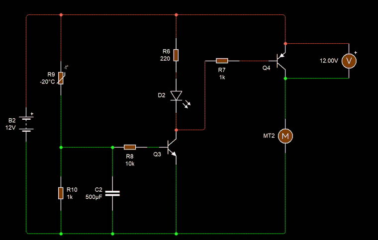

# Ep12 – Designing a Car-Factory Circuit for Testing Fans (Delayed Fan Turn-Off)

**Course:** Professional Electronic Design Course – Level 1 (Simple Electronic Design)
**Source:** Waleed Issa Academy – [تصميم دائرة لمصنع سيارات لفحص المراوح (Designing a car-factory circuit for testing fans)](https://www.youtube.com/watch?v=1Mw3kMX2Aks&list=PLww54WQ2wa5qVh1p8iPi7HspX7N9hbvbc&index=150) (video in Arabic)
**Tool:** Circuit Wizard

> This is my own English summary of the episode, written for study purposes. All credit for the content goes to Waleed Issa Academy.

---

## Overview

**The task:** the car factory from [ep11](../ep11-car-cooling-fan-control/) comes back with a change request. The thermistor fan controller works, but the fan switches off the moment the temperature drops. The factory wants the fan to **keep running a little longer** after the engine cools, so it doesn't keep flicking on and off around the switching temperature.

The tool for this is the **capacitor + resistor** pair. The episode first shows several ways an RC pair creates a time delay in DC circuits (delaying the *on*, delaying the *off*, or both), then uses one of them to modify the ep11 design, and finally tests it on real hardware.

**Prerequisites:** how a capacitor charges and discharges in a DC circuit, the Zener diode, the transistor switch, and the ep11 fan controller (NPN driver → PNP high-side switch → grounded fan).

---

## 1. The Rule of Thumb: R + C = Time Delay

In any DC circuit, if you see a **capacitor and a resistor in series** (in whatever shape), expect a **time delay**. A signal doesn't pass straight through. It has to wait while the capacitor charges or discharges.

The speed is set by the **time constant**:

$$\tau = R \cdot C$$

Charging from 0 V toward a supply $V_s$, and discharging from a starting voltage $V_0$:

$$V_C(t) = V_s\left(1 - e^{-t/RC}\right) \qquad\qquad V_C(t) = V_0\, e^{-t/RC}$$

After about $5\tau$ the capacitor is treated as fully charged (or fully empty). In practice, a transistor usually stops responding **before** $5\tau$, because it only needs about 0.7 V on its base, so the useful delay is often shorter.

Where the R and C sit decides **what** gets delayed: the turn-on, the turn-off, or both.

---

## 2. Three RC Shapes and What Each One Delays

All three examples start with a supply (e.g. 12 V), a push switch, a capacitor, a resistor, and "the next circuit" that should receive a signal.

### Shape A: switch feeds the capacitor directly → delayed **OFF**

- The capacitor sits from the switched line to ground, with **no resistor** in front of it. The next circuit hangs on the same line.
- **Press:** the capacitor charges almost instantly to the full supply, and the next circuit gets its signal straight away.
- **Release:** the supply is gone, but the charged capacitor now feeds the next circuit until it runs flat.

Turn-on is instant. **Turn-off is delayed.**

### Shape B: resistor in front of the capacitor → delayed **ON** (and a delayed off)

- A resistor sits between the switch and the capacitor. The next circuit is connected across the capacitor.
- **Press:** the resistor limits the current, so the capacitor charges **slowly** and its voltage climbs bit by bit. The next circuit does nothing until the voltage is high enough to drive it.
- **Release:** the stored charge keeps the next circuit going for a while.

**Turn-on is delayed** (and turn-off is delayed too).

### Shape C: capacitor in series with the signal path → turns **itself off**

- The capacitor is *in series* between the switch and a 10 kΩ resistor to ground.
- Current doesn't jump across the capacitor. Electrons pile up on one plate and push the same number off the other plate, so current *appears* to flow only while the capacitor is charging.
- **Press:** current flows at first, and the next circuit turns on. Once the capacitor is full, current stops and the next circuit turns **off, even while the switch is still held**.

So in every shape there is an ON and an OFF, and the RC pair puts a time delay **between** them.

---

## 3. Setting the Threshold: Diodes or a Zener Instead of the Resistor

In Shape B, how high must the capacitor voltage climb before the next stage works? With a plain resistor it's hard to say, because it depends on the current. You can **fix the threshold** by replacing that resistor with parts that have a known turn-on voltage:

| Part in the path | The capacitor must exceed |
|---|---|
| 2 silicon diodes in series | $2 \times 0.7 = 1.4\ \text{V}$ (plus whatever the next stage needs) |
| Zener diode, e.g. 5 V | $V_Z$ = 5 V (plus whatever the next stage needs) |
| Zener + transistor base-emitter | $V_Z + 0.7$ (e.g. $5.1 + 0.7 = 5.8\ \text{V}$) |

A higher threshold means the capacitor has to charge further, so the delay gets longer. This is one more knob for tuning the timing, besides R and C.

---

## 4. Example: A "Staircase Light" Timer (Delayed Off)

**Circuit:** 9 V battery → push switch → capacitor (charged directly, Shape A) → base resistor → NPN transistor → relay → 220 V lamp.

- **Press:** the capacitor charges to 9 V at once, the transistor saturates, the relay closes and the lamp lights.
- **Release:** the capacitor keeps supplying the base. Its voltage slowly falls until the transistor can no longer hold the relay, then the relay drops out and the lamp goes off.

The simulation in the video shows exactly that: the capacitor voltage keeps falling after the switch is released, the relay and lamp switch off at some point, and the capacitor keeps discharging toward 0 V through the transistor. The base resistor sets how fast it discharges, so it sets the on-time.

This is basically how a **staircase light** in apartment buildings works: press once, and the light stays on for a set time.

### Hardware version (12 V fan)

The instructor builds the same idea with a 12 V fan instead of a relay and 220 V lamp. Because the fan is grounded, it uses the **high-side driver** from ep11 (NPN driving a PNP), with 1 kΩ resistors in the driver stage, a 10 kΩ base resistor in front of the driver, and a **470 µF** capacitor charged directly by the switch. An LED shows when the switch is pressed.

- Hold the switch: the fan and LED run.
- Release: the LED goes out at once, but the **fan keeps spinning** on the capacitor's charge and stops several seconds later.

### Variation: a voltage divider + 5.1 V Zener (delayed **On**)

The circuit is changed only at the front:

- The switch now feeds a **10 kΩ resistor**, which forms a **voltage divider** with a second resistor. The capacitor sits on the divider's midpoint, so it charges slowly (Shape B).
- A **5.1 V Zener** sits between that node and the transistor base, so the node must reach $5.1 + 0.7 = 5.8\ \text{V}$ before the transistor turns on.

**Result on hardware:** after pressing, the fan waits about **4 seconds** before starting (the capacitor climbs 1 V, 2 V, 3 V… up to ≈ 5.8 V). On release it stops **almost immediately**, because the capacitor now discharges through the divider resistor *and* the transistor, and the moment it falls below 5.8 V the Zener cuts off.

Same parts, different placement, **opposite behaviour**.

---

## 5. Design Task: Delay the Fan's Turn-Off

**Brief:** modify the ep11 cooling-fan circuit (thermistor divider → NPN driver → PNP → grounded fan) so that when the temperature falls, the fan keeps running for a while (a few seconds or minutes, your choice) before switching off. Stopping the video and trying it yourself is part of the exercise.

### Step 1: add a capacitor at the driver's input

When it's hot, the thermistor's resistance drops, the divider midpoint rises, and the NPN turns on. The first idea: put a **capacitor from the midpoint to ground**. While hot, it charges; when it cools, the capacitor should keep feeding the NPN base.

In simulation:

- **100 µF:** practically no delay.
- **1000 µF:** the fan runs on for only about **1 second**.

With 10 kΩ and 1000 µF, $\tau = 10\ \text{k}\Omega \times 1000\ \mu\text{F} = 10\ \text{s}$, so a much longer delay was expected.

### Step 2: find where the charge is going

The capacitor is also connected across the **divider's bottom resistor** (a few hundred ohms). When it cools, most of the charge dumps through that small resistor instead of into the transistor base, so the delay collapses.

### Step 3: block the wrong path with a diode

A **diode** lets current flow one way only. Put it between the divider midpoint and the capacitor/base node:

- **While hot:** current flows from the divider *through the diode* and charges the capacitor (and drives the NPN).
- **When it cools:** the capacitor can't push current back through the diode into the bottom resistor. Its only way out is **through the base resistor into the transistor**.

Now the fan keeps running much longer after the temperature drops. The capacitor voltage drops below 1 V, the LED dims, the fan slows, and finally it stops.

### Component values (hardware build)

| Part | Value |
|---|---|
| Supply | 12 V |
| Fan | 12 V DC fan (to ground), blowing on the sensor |
| High-side PNP | **BD140** |
| Driver | NPN transistor + 1 kΩ |
| Indicator | LED + 220 Ω |
| Base resistor (cap → driver) | **10 kΩ** |
| Timing capacitor | **470 µF** |
| Blocking diode | silicon diode, divider → capacitor |
| Divider | NTC thermistor (top) + **220 Ω** (bottom) |

### Hardware test

The fan blows straight at the thermistor, and a soldering iron is the heat source.

- **With the capacitor:** heat the sensor → LED and fan turn on. Remove the iron → even though the fan cools the sensor quickly, the fan **keeps running for a while** until the capacitor has emptied, then stops.
- **Capacitor removed:** with the iron held near the sensor, the fan turns on, cools the sensor, turns off, heats up again, turns on… It **flickers on and off** constantly even though the heat source is still there.

So the capacitor makes the circuit far more **stable**: the fan runs long enough to be sure the temperature has really dropped. As the instructor puts it, this is the difference between a beginner's design and a more professional one.

---

## My Circuit Wizard Simulations

Both files are in [`media/`](./media/). The GIFs play on this page (1.5× speed, cropped to the circuit). Click the MP4 links for the full recordings. In both circuits the voltmeter sits across Q2/Q4's collector and emitter, so it shows the voltage **wasted** in the PNP. 12.00 V = fan off; the lower it reads, the more voltage reaches the fan.

The Circuit Wizard thermistor is **33 kΩ at 25 °C** (4.08 kΩ at 80 °C, ≈ 358 kΩ at −20 °C), much larger than the instructor's ≈ 8 kΩ part. So I used **1 kΩ** for the divider's bottom resistor instead of 220 Ω, which gives a similar switching point.

### 1. With the blocking diode (the episode's final design)

*The thermistor R4 is jumped from −20 °C to 80 °C: the LED D1 lights and the fan MT1 spins right away. Then R4 is set back to −20 °C. Watch the voltmeter: instead of jumping back to 12 V, it creeps up from 8.2 V to 11.46 V over about 16 s while the LED fades and the fan slows down.* · [MP4](media/ep12-sim-fan-delay-with-diode.mp4)

- **Setup:** R4 = NTC (33 kΩ at 25 °C) from +12 V to the divider midpoint; R5 = 1 kΩ from midpoint to ground; D3 from midpoint to the C1/R3 node; C1 = 470 µF to ground; R3 = 10 kΩ to Q1 (NPN) base; green D1 + R1 = 220 Ω from +12 V to Q1 collector; R2 = 1 kΩ from Q1 collector to Q2 (PNP) base; Q2 emitter to +12 V, collector → fan MT1 → ground.

Readings (real time, from the recording):

| Time after cooling | $V_{CE}$ of Q2 | Fan gets | LED / fan |
|---|---|---|---|
| hot (80 °C) | 7.66–8.23 V | ≈ 3.8–4.3 V | On |
| 0 s (set to −20 °C) | 8.23 V | ≈ 3.8 V | On |
| 3 s | 9.47 V | ≈ 2.5 V | On |
| 6 s | 10.15 V | ≈ 1.9 V | On |
| 9 s | 10.70 V | ≈ 1.3 V | LED dimming |
| 12 s | 11.10 V | ≈ 0.9 V | LED very dim |
| 13 s | 11.20 V | ≈ 0.8 V | LED off, fan barely turning |
| 17 s | 11.46 V | ≈ 0.5 V | Off (settled) |

### 2. Without the diode (capacitor only)

*Same circuit, but the divider midpoint connects straight to C2 (500 µF) and R8, with no diode. R9 is jumped to 80 °C (fan on, 7.89 V across Q4) and then back down. Watch how fast it ends: within about 1 s the voltmeter is back at 12.00 V and the LED is out.* · [MP4](media/ep12-sim-fan-delay-no-diode.mp4)

- **Setup:** R9 = NTC (33 kΩ at 25 °C); R10 = 1 kΩ; C2 = 500 µF across R10; R8 = 10 kΩ to Q3 base; D2 + R6 = 220 Ω; R7 = 1 kΩ; Q4 (PNP) high side; fan MT2 to ground.

### Expected vs. simulated

**Hot divider voltage** (no diode, ignoring the base current):

$$V_{mid} = 12 \times \frac{1\ \text{k}\Omega}{4.08\ \text{k}\Omega + 1\ \text{k}\Omega} \approx 2.36\ \text{V}$$

With the diode, C1 charges to about $2.36 - 0.7 \approx 1.6\ \text{V}$. The charging path is the divider (≈ 0.8 kΩ Thévenin) plus the diode, so $\tau_{charge} \approx 0.8\ \text{k}\Omega \times 470\ \mu\text{F} \approx 0.4\ \text{s}$. **Turn-on is fast** ✔ (the fan started within about a second in both runs).

**Turn-off, with the diode:** C1 can only empty through R3 into Q1's base, and it stops mattering once it falls to ≈ 0.65 V. So it decays toward 0.65 V with

$$\tau = R_3 C_1 = 10\ \text{k}\Omega \times 470\ \mu\text{F} = 4.7\ \text{s}$$

Going from ≈ 1.6 V down to ≈ 0.75 V (where the base current is nearly gone) takes about $4.7 \times \ln\frac{1.6 - 0.65}{0.75 - 0.65} \approx 4.7 \times 2.2 \approx 10.5\ \text{s}$. **Simulated: LED out after ≈ 13 s, fan settled after ≈ 16 s** ✔. That's a good match for a rough estimate.

**Turn-off, without the diode:** C2 now also discharges through R10 = 1 kΩ, so $\tau \approx (1\ \text{k}\Omega \parallel 10\ \text{k}\Omega) \times 500\ \mu\text{F} \approx 0.45\ \text{s}$. **Simulated: off in ≈ 1 s** ✔. This is exactly the problem the instructor found in Step 2: the small divider resistor steals the charge.

| Version | Discharge path | $\tau$ (calc.) | Turn-off delay (sim) |
|---|---|---|---|
| No diode, 500 µF | R10 ∥ (R8 + base) | ≈ 0.45 s | ≈ 1 s |
| Diode, 470 µF | R3 + base only | 4.7 s | ≈ 13 s (LED), ≈ 16 s (fan) |

So the diode gives a **≈ 10–15× longer delay** with a slightly *smaller* capacitor.

### Two things I noticed

- **The PNP still doesn't saturate ✘.** Even at 80 °C the voltmeter reads 7.7–8.2 V, so the fan only gets ≈ 4 V. It's the same issue I found in ep11. Q1's base gets only about $\frac{1.6 - 0.65}{10\ \text{k}\Omega} \approx 0.1\ \text{mA}$, so with $\beta \approx 300$ it can sink only ≈ 30 mA. But the LED branch alone wants up to $\frac{12 - 2}{220} \approx 45\ \text{mA}$, so Q1 never saturates and Q2's base is never pulled firmly to 0 V.
- **The fan fades out, it doesn't switch off cleanly.** During the delay, both transistors slide gradually through their active region: the LED dims and the fan slows over ≈ 15 s. In the video it looks the same (the LED dims and the fan slows before stopping). That's fine for a fan, but the transistor heats up during the fade ($P = V_{CE} \times I_C$), and a relay would chatter instead of dropping out cleanly.

---

## What I Learned

- **R + C in a DC circuit = time delay.** $\tau = RC$; after ≈ $5\tau$ the capacitor is full or empty, but a transistor often stops responding before that.
- **Where** the R and C sit decides what's delayed: a capacitor charged directly gives a delayed **off**, a resistor in front of it gives a delayed **on**, and a series capacitor gives a pulse that turns **itself off**.
- Diodes ($n \times 0.7$ V) or a Zener ($V_Z + 0.7$ V) in the path set a fixed **threshold** voltage, which is another way to tune the delay.
- A staircase light is just a capacitor holding a transistor (and relay) on after the button is released.
- Adding a capacitor isn't enough. You have to check **where it discharges**. A small resistor in parallel empties it in a fraction of a second.
- A **blocking diode** forces the capacitor to discharge only into the transistor base, so the fan's turn-off is delayed while its turn-on stays fast.
- The delay also stops the **on/off flickering** that happens when the fan cools its own sensor, making the circuit much more stable.
- **From my simulations:** with the diode the fan ran on for ≈ 13–16 s ($\tau$ = 4.7 s); without it, ≈ 1 s ($\tau$ ≈ 0.45 s). Both match the RC estimates.
- The PNP still wastes ≈ 8 V because the NPN driver is starved of base current. Fixing the driver from ep11 is still on my list.

### Next to try

- Fix saturation without spoiling the delay: raise R1 (LED resistor) from 220 Ω to ≈ 2.2 kΩ so the LED takes ≈ 4.5 mA instead of ≈ 45 mA, and check that Q2's $V_{CE}$ drops below ≈ 0.5 V when hot.
- Try C1 = 1000 µF and R3 = 22 kΩ ($\tau$ = 22 s) and compare the measured delay with the estimate.
- Add an ammeter in series with the fan and plot fan current vs. time during the turn-off fade.
- Build the Zener "delayed on" variation from Section 4 in Circuit Wizard and time the ≈ 4 s start delay.
