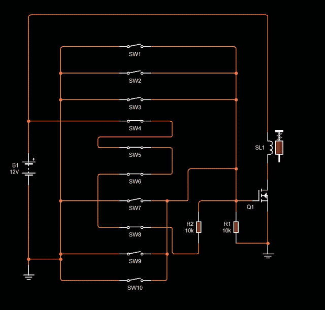

# Ep14 – Designing a Secret-Code Circuit Without Programming

**Course:** Professional Electronic Design Course – Level 2 (Advanced Electronic Design)
**Source:** Waleed Issa Academy – [تصميم دائرة كود سري من غير برمجة (Designing a secret-code circuit without programming)](https://www.youtube.com/watch?v=-NGo9LkL8vQ) (video in Arabic)
**Tool:** Circuit Wizard

> This is my own English summary of the episode, written for study purposes. All credit for the content goes to Waleed Issa Academy.

---

## Overview

This is the first episode of **Level 2: Advanced Electronic Design**. In this level, circuits start to "decide" for themselves: they turn a load on or off based on their inputs, **with no programming and no microcontroller**, only basic parts.

**The task:** a homeowner wants to lock a room with an **electronic lock** (a solenoid). There are ten separate switches labelled **0–9**. The door must open **only** when switches **4, 5, 6 and 8** are all on, and it must **stay locked** if:

- any of those four is missing (wrong code), or
- any **extra** switch is also on (e.g. 4, 5, 6, 8 **and** 9).

**Given parts:** a 9 V or 12 V battery, a **12 V solenoid** (the lock), ten fully independent switches. Any basic parts are allowed (diodes, LEDs, transistors, resistors, capacitors, inductors). The instructor encourages using a **MOSFET** this time instead of an NPN/PNP.

**Switch type:** the switches are **latching on/off** (toggle) switches. You flip each one and it stays on. With push buttons you'd have to hold four buttons down at once.

**Prerequisites:** how the transistor works, and the **MOSFET** from the Practical Electronics Course (gate, gate capacitance, $V_{GS(th)}$, $R_{DS(on)}$).

---

## 1. Designing It Step by Step

The design is built up in four steps. Each step fixes a problem found in the one before.

### Step 1: The four correct switches in series → solenoid

Solenoid to ground, and +12 V reaches it only through switches 4 → 5 → 6 → 8 **in series**.

- **Series**, not parallel: in parallel, *any one* switch would open the lock. In series, current flows only when **all four** are closed (an AND condition).

| Goal | Met? |
|---|---|
| All four correct switches → open | ✔ |
| Missing or wrong code (e.g. only 4, 5, 8) → locked | ✔ |
| Extra switch also on (e.g. 4, 5, 6, 8 + 2) → locked | ✘ The other switches aren't connected to anything, so they're simply ignored |

So anyone who flips **all ten** switches gets in. This design isn't good enough.

### Step 2: Put a MOSFET between the solenoid and ground

Instead of feeding the solenoid directly, the series chain drives **something before the lock** that can be turned **on** by the right switches and **off** by any wrong one. A relay, a transistor or another sensor could do it. Here it's an **N-channel MOSFET** used as a **low-side switch**:

- Solenoid: one end on **+12 V**, the other end on the MOSFET **drain**.
- MOSFET **source** on ground.
- The end of the 4-5-6-8 chain now goes to the MOSFET **gate**.

**Always add a gate pull-down resistor** (gate → ground, **10 kΩ to 1 MΩ**). A MOSFET gate is basically a small **capacitor**. Once it's charged it stays charged, so the MOSFET can stay on after the drive is removed (even touching the gate with a finger can switch it). The pull-down discharges the gate so the MOSFET is really **off** when nothing drives it.

Result: the correct code turns the lock on, but extra switches still don't do anything yet.

### Step 3: Wrong switches pull the gate to 0 V (and short the battery ✘)

A MOSFET turns off when its gate is at **0 V**. So every **wrong** switch (0, 1, 2, 3, 7, 9) is wired from **ground** to the **gate**. Flipping any of them forces the gate to 0 V.

The problem: if the correct code is also on, the gate is connected to **+12 V** through 4-5-6-8 **and** to **ground** through the wrong switch, at the same time. That's a **short circuit across the battery**:

- a **lithium** battery can overheat or even explode,
- a lead-acid or ordinary battery drains completely within minutes.

The lock does stay shut, but the design is unsafe.

### Step 4: A 10 kΩ series resistor stops the short ✔

Put a **10 kΩ resistor** between the end of the correct-switch chain and the gate. The gate still gets enough voltage, but there's never a direct path from +12 V to ground.

**Correct code, no wrong switches:** the series 10 kΩ and the 10 kΩ pull-down form a voltage divider (the gate draws no DC current):

$$V_G = 12\ \text{V} \times \frac{10\ \text{k}\Omega}{10\ \text{k}\Omega + 10\ \text{k}\Omega} = 6\ \text{V}$$

6 V is well above the 2N7000's $V_{GS(th)}$ (0.8–3 V), so the MOSFET turns on and the lock opens.

**Correct code + any wrong switch:** the gate is tied straight to ground → $V_G \approx 0\ \text{V}$ → lock stays shut. The only current that flows is through the series resistor:

$$I = \frac{12\ \text{V}}{10\ \text{k}\Omega} = 1.2\ \text{mA}$$

That's tiny, so the battery is safe.

| Switches on | Gate voltage | Lock |
|---|---|---|
| None, or only some of 4/5/6/8 | 0 V (pull-down) | Locked |
| 4, 5, 6, 8 only | ≈ 6 V | **Open** |
| 4, 5, 6, 8 + any wrong switch | ≈ 0 V (1.2 mA through 10 kΩ) | Locked |
| Wrong code (e.g. 0, 5, 6, 8) | 0 V | Locked |

All three goals are met by adding just **one MOSFET and two resistors** to the basic series chain.

---

## 2. The Hardware Build

| Part | Value / type |
|---|---|
| Supply | 12 V |
| Lock | 12 V solenoid (the plunger pulls in to unlock the door) |
| Switch element | **2N7000** N-channel MOSFET (low side) |
| Gate series resistor | **10 kΩ** (prevents the short) |
| Gate pull-down | **10 kΩ** (discharges the gate) |
| Flyback diode | silicon diode **reversed across the solenoid** (needed with any coil: motor, relay, solenoid) |
| Switches | 10 × latching on/off switches in two rows: 0–4 and 5–9 |

**Test on the board:** 4 → 5 → 6 → 8 on → the MOSFET turns on and the solenoid pulls in. Adding 7, 0 or 1 → it releases at once. Starting with 0, 5, 6, 8 (no 4) → nothing happens.

**Limitation:** the switches stay where you put them, so after opening the door someone has to **scramble them again**, like the dials on a luggage combination lock. That's fine for a small safe or a kids' learning project, but it's not great for a room door.

---

## 3. BJT or MOSFET? Three Questions to Ask

A professional designer should be able to say *why* they picked a part. Before choosing between a **BJT** (NPN/PNP) and a **MOSFET**, ask these three questions.

### Q1: Does the on/off switching need to be fast?

A chart from a textbook shown in the video compares operating frequencies:

- **BJT:** low frequencies, roughly 0 to about 10 kHz.
- **MOSFET:** up to roughly 1000 kHz.

If the circuit must switch very fast (e.g. **100 kHz**), use a **MOSFET**. A door lock doesn't care about a second either way, so **both** are fine here.

*What about an IGBT?* It's expensive and made for **high voltages and currents**. It isn't really available for small 12 V, low-current jobs like this, so it makes no sense here.

### Q2: How much power is lost as heat?

The power a transistor wastes as heat should be as small as possible.

$$P_{BJT} = V_{CE(sat)} \times I_C \qquad\qquad P_{MOSFET} = I_D^{\,2} \times R_{DS(on)}$$

For a BJT you must make sure it's in **saturation**. Values from the datasheets of two parts from the instructor's lab:

| | **BC547B** (BJT) | **2N7000** (MOSFET) |
|---|---|---|
| Key loss parameter | $V_{CE(sat)}$ = 0.2–0.6 V at 100 mA → worst case **0.6 V** | $R_{DS(on)}$ ≈ **5 Ω** |
| Max current | 100 mA | ≈ 200 mA drain current |
| Turn-on voltage | $V_{BE(on)}$ ≈ 0.6–0.7 V | $V_{GS(th)}$ = 0.8–3 V |

With the lock drawing **100 mA**:

$$P_{2N7000} = (0.1\ \text{A})^2 \times 5\ \Omega = 50\ \text{mW}$$

$$P_{BC547B} = 0.6\ \text{V} \times 0.1\ \text{A} = 60\ \text{mW}$$

These are almost the same, so neither is clearly better here. The difference only matters when it's large, e.g. a BJT with $V_{CE(sat)}$ = 0.2 V (≈ 20 mW) or a MOSFET with a much smaller $R_{DS(on)}$.

### Q3: What voltage drives the input?

Know where the gate/base signal comes from (a microcontroller, a big circuit, a low-voltage circuit) so you know whether the transistor will actually turn on.

- BJT: needs $V_{BE}$ ≈ **0.7 V**.
- 2N7000: needs $V_{GS(th)}$ = **0.8–3 V**, and more than that to turn fully on.

If the drive voltage is low, the MOSFET might not turn on, so it would be the worse choice. Here the gate gets **6 V** from a 12 V supply, so both work.

**Conclusion:** for this project, a BJT and a MOSFET are equivalent on all three questions. The MOSFET was chosen to try a different design style. If a BJT does the job, a BJT is fine.

---

## 4. Other Ways to Build the Same Circuit

The instructor showed a few versions found online that use the same idea:

- **NPN version:** the correct switches in series feed the transistor **base** through resistors (to limit the base current), and all wrong switches connect the base to **ground**, cancelling any drive from the correct chain. The load (lock) is on the collector side.
- **DIP-switch version:** a small **DIP switch** block replaces the big toggle switches, and a **relay** replaces the solenoid, so it can switch anything. Here +12 V passes through a resistor (to prevent the short), then switches **1 → 3 → 6** to the base. Every other switch grounds the base, and a **10 kΩ** resistor holds the base at ground when nothing drives it.

Most people would reach for a microcontroller, programming or an IC for this task. Thinking in terms of **series = AND**, **"pull to 0 V" = veto**, and **a resistor so that veto can't short the supply** solves it with three or four parts.

---

## My Circuit Wizard Simulation

All files are in [`media/`](./media/). The GIF plays on this page (1.5× speed, cropped to the circuit). Click the MP4 link for the full recording.

*The four code switches (SW4, SW5, SW6, SW8) start closed, so the gate wire is red (high) and the solenoid SL1 is pulled in. Watch the gate and the solenoid plunger: opening SW4 drops the gate to 0 V (green) and the plunger springs out. With SW4 closed again and a wrong switch also on, the code chain turns red right up to R2 but the gate stays green (locked, no short). Opening the wrong switch pulls the solenoid in again.* · [MP4](media/ep14-sim-secret-code-lock.mp4)

📁 Circuit file: [ep14-secret-code-lock.cwz](./ep14-secret-code-lock.cwz)

### How my circuit is wired

My switches are numbered **SW1–SW10**: SW1–SW9 stand for digits 1–9 and SW10 for digit 0. The code 4-5-6-8 is **SW4 → SW5 → SW6 → SW8**.

| Part | Connection |
|---|---|
| B1 = 12 V (ideal) | + to the top rail, − to ground |
| SW4 → SW5 → SW6 → SW8 | in series from +12 V (the code chain) |
| R2 = 10 kΩ | from the end of SW8 to the gate (the series resistor that prevents the short) |
| R1 = 10 kΩ | gate to ground (the pull-down) |
| SW1, SW2, SW3, SW7, SW9, SW10 | each one from ground to the gate (the wrong switches) |
| Q1 = N-channel MOSFET (ideal) | source to ground, drain to the solenoid |
| SL1 = Solenoid (6 V DC) | between +12 V and the drain |

This is the Step 4 design from section 1. Two differences from the instructor's hardware build:

- Circuit Wizard's solenoid is the **6 V** model, while the video uses a **12 V** solenoid. On a 12 V supply it gets about twice its rating, which is fine in a simulation but not on real hardware.
- There's **no flyback diode** across the solenoid. It doesn't matter much in the simulation, but any real build needs one.

### What happens in the recording

In Circuit Wizard's voltage view, **red = high voltage** and **green = near 0 V**.

| Sim time | Switches on | Code chain | Gate | Solenoid | Matches the design? |
|---|---|---|---|---|---|
| 0.3–1.5 s | SW4, SW5, SW6, SW8 | red (12 V) | red (high) | pulled in (open) | ✔ |
| ≈ 2.2–6 s | SW4 opened (code incomplete) | green | green (0 V) | released (locked) | ✔ |
| ≈ 7.4–8.1 s | SW4, 5, 6, 8 + a wrong switch | red up to R2 | green (0 V) | released (locked) | ✔ no short: R2 takes the 12 V |
| ≈ 9.2–14.5 s | wrong switch opened → code only | red | red (high) | pulled in again | ✔ |

The third row is the important one. The whole code chain is at 12 V and the gate is at 0 V at the same time, and the only thing between them is R2. So the voltage drops across R2 instead of across a wire, and the current is only

$$I = \frac{12\ \text{V}}{10\ \text{k}\Omega} = 1.2\ \text{mA}$$

**Expected gate voltage with the correct code** (R2 and R1 as a divider):

$$V_G = 12\ \text{V} \times \frac{10\ \text{k}\Omega}{10\ \text{k}\Omega + 10\ \text{k}\Omega} = 6\ \text{V}$$

I didn't put a voltmeter or ammeter in this run, so the 6 V and 1.2 mA are calculated values. The simulation only confirms on/off behaviour.

---

## What I Learned

- **Series switches = AND:** current only flows when all of them are closed. Parallel switches = OR.
- Ignoring extra inputs isn't the same as rejecting them. The wrong switches have to do something active: **pull the gate to 0 V**.
- Pulling a node to ground while the supply is also connected to it is a **battery short**. A **series resistor** turns that short into a harmless 1.2 mA while still letting the gate reach 6 V.
- A MOSFET gate is a capacitor: always fit a **gate pull-down** (10 kΩ–1 MΩ), or the MOSFET can stay on by itself.
- Coils (solenoids, relays, motors) always need a **reversed diode** across them.
- Choosing BJT vs. MOSFET comes down to **switching speed**, **power loss** ($V_{CE(sat)} I_C$ vs. $I_D^2 R_{DS(on)}$) and **drive voltage** vs. $V_{BE}$ / $V_{GS(th)}$. For this lock they're equivalent (≈ 60 mW vs. ≈ 50 mW).
- **From my simulation:** code SW4-5-6-8 → solenoid pulls in; breaking the code → released; code + a wrong switch → the chain stays at 12 V up to R2 while the gate sits at 0 V, so the lock stays shut with no short. Removing the wrong switch unlocks it again.

### Next to try

- Add a voltmeter on the gate (expect ≈ 6 V with the code) and an ammeter in series with R2 (expect ≈ 1.2 mA with the code + a wrong switch).
- Remove the series 10 kΩ and add an ammeter to see how large the short-circuit current gets.
- Remove the pull-down resistor and see whether the ideal MOSFET stays on after the code is broken.
- Add a flyback diode across the solenoid and use a 12 V solenoid model (or a 6 V supply).
- Swap the MOSFET for a BC547B + base resistor and compare the load voltage and power loss.
