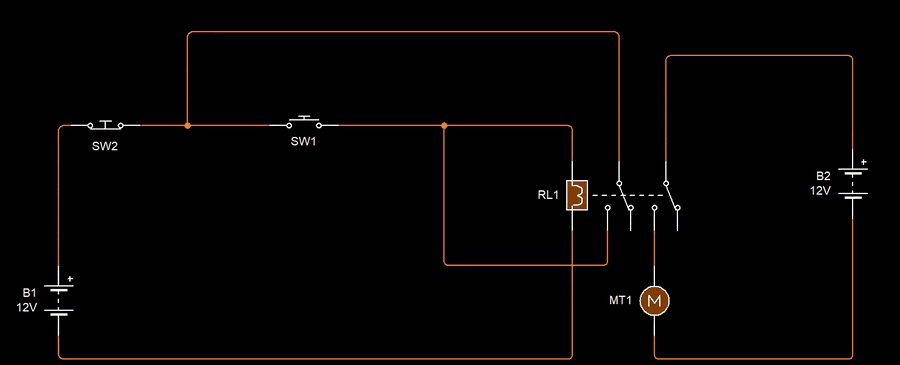

# Ep17 – Designing a One-Press Electric Drill Circuit with a Relay

**Course:** Professional Electronic Design Course – Level 2 (Advanced Electronic Design)
**Source:** Waleed Issa Academy – [تصميم دائرة لمثقاب كهربي يعمل بضغطة واحدة بالريليه (Designing a circuit for an electric drill that runs with a single press, using a relay)](https://www.youtube.com/watch?v=NRql0CMkTiI&list=PLww54WQ2wa5qVh1p8iPi7HspX7N9hbvbc&index=155) (video in Arabic)
**Tool:** Circuit Wizard

> This is my own English summary of the episode, written for study purposes. All credit for the content goes to Waleed Issa Academy.

---

## Overview

You need to know how a **relay** works (coil, **COM**, **NC**, **NO**) before this episode.

**The task:** a workshop owner has a drill that only runs **while he keeps his finger on the button**. As soon as he lets go, it stops. He wants:

- **one press** on an **ON** button → the drill keeps running, so both hands are free to hold the workpiece,
- **one press** on an **OFF** button → the drill stops.

Like a bench drill with separate ON and OFF buttons. Both buttons are **momentary**: they spring back after you press them.

**The rule:** use **relays only**. No transistors, diodes, resistors or programming.

The instructor's point: the simplest design is usually the most professional one. Knowing which part does the job (here, a relay) saves you from reaching for things you don't actually need.

---

## 1. Why a Relay?

- The drill might run on **12 V DC** or on **220 V AC** mains. A transistor can't simply switch mains, but a relay can.
- A relay **separates** two circuits: a small **control circuit** (buttons + coil) and a **load circuit** (supply + drill). The load side can be any voltage the contacts are rated for.
- The relay chosen has **two contact sets** on one coil (**DPDT**, "two-contact relay"). One set runs the drill, the other is used for the latch (section 3).

---

## 2. First Try: A Push-to-Make Button on the Coil

| Part | Connection |
|---|---|
| Control side | 12 V battery + → **push-to-make** button → relay coil → battery − |
| Load side | supply + → relay contact 2 **COM** → **NO** → drill → supply − |

Press the button → the coil gets 12 V → contact 2 closes → the drill runs.

✘ **Same problem as before.** A push-to-make button only connects while it's held down. Let go and the coil loses power, so the drill stops. We've just moved the problem from the drill's switch to our button.

---

## 3. The Latch (Self-Holding Relay)

**Latch** (لاتش) means "hold" or "catch": the circuit **holds itself on** after a single signal.

The idea: the relay coil needs +12 V to stay on. The button gives it that, but only for a moment. So give the coil **a second path** to +12 V that only exists **once the relay is already on**: through its **own contact**.

| Part | Connection |
|---|---|
| Contact 1 **COM** | +12 V |
| Contact 1 **NO** | the coil's + end (the same point the button feeds) |

So contact 1 is wired **in parallel with the ON button**.

1. Press ON → +12 V reaches the coil through the button → the relay switches.
2. Contact 1 closes → +12 V now **also** reaches the coil through contact 1.
3. Release ON → the button path opens, but the contact path is still there. The relay **feeds itself** and stays on.

The relay is now **latched**, and the drill keeps running.

> **General rule from the episode:** find the part you want to *stay* on, then give it power through **another path** than the usual switch.

---

## 4. Adding the OFF Button

Now the relay holds itself forever. The only way to stop it would be to unplug the battery. We need a button that **breaks** the supply to the coil.

That's a **push-to-break** switch (normally closed): it **conducts at rest** and **opens while pressed**.

Put it in series with the **+12 V line, before** the point where the ON button and the latch contact split:

```
+12 V ── OFF (push-to-break) ──┬── ON (push-to-make) ──┬── coil ── 0 V
                               │                       │
                               └── contact 1 COM → NO ─┘
```

| Action | What happens | Drill |
|---|---|---|
| Nothing pressed | coil has no path to +12 V | off |
| Press **ON** once | coil powered through ON, then through contact 1 → latched | **runs** |
| Release ON | coil still fed through contact 1 | **keeps running** |
| Press ON again (or hold it) | nothing changes, it's already latched | runs |
| Press **OFF** once | +12 V is cut from **both** paths → coil drops out → contact 1 opens | **stops** |
| Release OFF | contact 1 is now open, so nothing reconnects the coil | stays off |

When you buy switches you'll see the two types called:

- **NO / normally open** (push-to-make) → the ON button
- **NC / normally closed** (push-to-break) → the OFF button

Many micro switches have **three** terminals (COM, NO, NC), like the ones from ep16. Use **COM + NO** for ON and **COM + NC** for OFF.

---

## 5. Changing the Load Voltage

The load circuit (contact 2 + supply + drill) is **completely separate** from the control circuit. To run a **220 V AC** drill, just replace the load supply. Nothing else changes, as long as the relay contacts are rated for 220 V AC and the load current. The instructor showed this in Circuit Wizard with a lamp, because the program has no 220 V motor.

**Doing it all on 220 V:** you could also skip the 12 V battery and run the control circuit from mains too. That's what's actually used in practice, but then:

- the **buttons** must be rated for 220 V, and
- the relay must have a **220 V AC coil** (Circuit Wizard doesn't have one, so it couldn't be shown).

The wiring stays exactly the same. With a relay, moving a design from a small low-voltage system to a big high-voltage one is easy.

---

## 6. The Hardware Build

| Part | What was used |
|---|---|
| Relay | 12 V, two contact sets: one for the latch, one for the motor |
| Buttons | two 3-terminal micro switches: **COM + NO** for ON, **COM + NC** for OFF |
| Load | first a small 12 V DC motor, then a real **12 V drill** with its own 12 V power supply |

- One press on ON → runs continuously. Pressing ON again, or holding it, changes nothing.
- One press on OFF → stops.
- Before, the drill's cable had to be plugged into and unplugged from the 12 V supply every time. With this small circuit soldered and mounted on the drill, it gets a proper ON/OFF.

**Why this episode matters:** it's an introduction to the next one. The relay latch is the reference design. Later episodes build the same "one press" behaviour in other ways (e.g. a transistor latch in ep18), and you're meant to **write notes, compare the designs and judge which is better**, as a designer and a critic.

---

## My Circuit Wizard Simulations

All files are in [`media/`](./media/). The GIFs play on this page (cropped to the circuit). Click the MP4 links for the full recordings. In Circuit Wizard's voltage view, **red = high voltage** and **green = near 0 V**. Times in the tables are from the MP4s.

📁 Circuit file: [ep17-one-press-relay-latch.cwz](./ep17-one-press-relay-latch.cwz) – both circuits (3 × 12 V ideal battery, 1 × 12 V / 60 Hz AC source, 2 × DPDT relay (6 V), 2 × push-to-make switch, 2 × push-to-break switch, 1 × DC motor (3 V), 1 × signal lamp (6 V, 60 mA))

**Part ratings:** the relays are Circuit Wizard's **6 V** DPDT relay, the motor is the **3 V** DC motor and the lamp is a **6 V** signal lamp, all running on 12 V here. That's fine for checking the logic in a simulation. A real build should use parts rated for the supply (a 12 V relay coil and a 12 V motor, as in the video).

| Part | Sim 1 | Sim 2 |
|---|---|---|
| Control supply | B1 = 12 V battery | B3 = 12 V battery |
| ON button (push-to-make) | SW1 | SW3 |
| OFF button (push-to-break) | SW2 | SW4 |
| Relay | RL1 | RL2 |
| Load supply | B2 = 12 V battery (separate) | V1 = 12 V / 60 Hz AC source |
| Load | MT1 = DC motor (the "drill") | BL1 = lamp |

**Wiring (both sims):** battery + → **OFF** → junction. From the junction: **ON** → coil +, and a wire to **contact 1 COM**. **Contact 1 NO** → coil + (the latch). Coil − → battery −. Load supply + → **contact 2 COM**, **contact 2 NO** → load → load supply −.

---

### Sim 1 – Relay latch driving a 12 V motor



*A single click on SW1 (ON) turns the whole control loop red and MT1 starts spinning. Watch what happens after SW1 is released: the loop **stays red**, because contact 1 now feeds the coil. One click on SW2 (OFF) turns the loop green and the motor stops.* · [MP4](media/ep17-sim-relay-latch-drill-12v.mp4)

| Time | Action | Coil | MT1 |
|---|---|---|---|
| 0–2 s | (not simulating) | – | – |
| 3 s | nothing pressed | 0 V (green) | stopped ✔ |
| 4 s | click **SW1** (ON) | +12 V | **runs** ✔ |
| 5–6 s | SW1 released | +12 V through contact 1 | **keeps running** ✔ latched |
| 7 s | click **SW2** (OFF) | 0 V | stops ✔ |
| 8 s | nothing pressed | 0 V | stays stopped ✔ |
| 9 s | click **SW1** again | +12 V | runs ✔ |
| 10–16 s | hands off | +12 V (latched) | keeps running ✔ |
| 17 s | click **SW2** | 0 V | stops ✔ |
| 18 s | simulation stopped | – | – |

✔ Matches the truth table in section 4: one click starts it, it holds on its own, one click stops it, and it stays off until ON is pressed again.

**Note on the colours:** the motor side (B2) is a **separate battery** with no wire to B1, so it has no shared 0 V reference with the control side. That's why Circuit Wizard draws the load loop in orange/blue instead of red/green. It also shows the point of section 1: the load circuit is **electrically isolated** from the buttons.

---

### Sim 2 – Same latch switching an AC load (lamp)


*Here the load side is a 12 V / 60 Hz **AC** source and a lamp, standing in for the 220 V drill (Circuit Wizard has no 220 V motor). One click on SW3 latches RL2 and BL1 lights, one click on SW4 turns it off. The flickering colours on the lamp side are the AC voltage changing direction.* · [MP4](media/ep17-sim-relay-latch-ac-lamp.mp4)

| Time | Action | Coil | BL1 |
|---|---|---|---|
| 0–2 s | (not simulating / idle) | – | off |
| 3 s | click **SW3** (ON) | 0 V → +12 V | off → **on** |
| 4–8 s | SW3 released | +12 V (latched) | **stays on** ✔ |
| 9 s | click **SW4** (OFF) | 0 V | off ✔ |
| 10–12 s | nothing pressed | 0 V | stays off ✔ |

✔ The control side is identical to Sim 1. Only the load supply changed (DC → AC) and the latch doesn't care. To make it 220 V you'd only change V1 (and use contacts rated for it).

---

## What I Learned

- A **push-to-make** button alone can't keep a load on: it only conducts while held.
- **Latch:** give the relay coil a second path to the supply **through its own NO contact**, in parallel with the ON button. Once on, the relay holds itself.
- A **push-to-break** (NC) button in series with the supply, **before** the ON/latch split, is the OFF button. It cuts both paths at once.
- A **DPDT** relay does two jobs at once: contact 1 latches, contact 2 switches the load.
- The load circuit is **isolated** from the control circuit, so the same design switches 12 V DC or 220 V AC. Only the load supply and the contact rating change (**from my Sims 1 and 2**).
- Pressing ON while it's already latched does nothing, so the circuit can't be "confused" by extra presses.

### Next to try

- Join the − of B1 and B2 in Sim 1 to give both circuits a common 0 V, and see the load loop switch to normal red/green colours.
- Try what happens if the **OFF** button is put **after** the junction, in series with only the ON button (it shouldn't be able to stop the latch).
- Compare this relay latch with the **transistor latch** from ep18: parts count, standby power (a relay coil draws current the whole time it's on) and what happens after a power cut.
- In a real build, add a **flyback diode** across the coil (outside this episode's "relays only" rule) to protect the buttons and contacts when the coil switches off.
