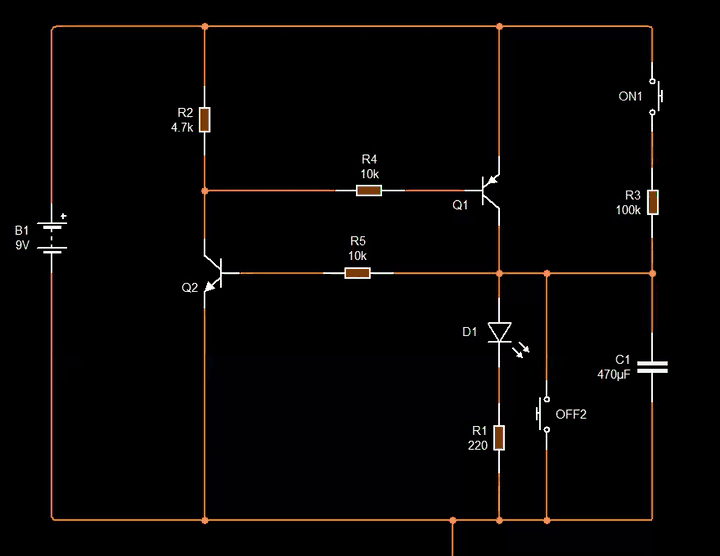

# Ep18 – Designing a Transistor Latch Circuit with a Delay

**Course:** Professional Electronic Design Course – Level 2 (Advanced Electronic Design)
**Source:** Waleed Issa Academy – [تصميم دائرة ماسك بالترانزستور مع تأخير تجنب الكثير من المشاكل (Designing a transistor latch circuit with a delay that avoids many problems)](https://www.youtube.com/watch?v=AhfazNI4Wiw&list=PLww54WQ2wa5qVh1p8iPi7HspX7N9hbvbc&index=156) (video in Arabic)
**Tool:** Circuit Wizard

> This is my own English summary of the episode, written for study purposes. All credit for the content goes to Waleed Issa Academy.

---

## Overview

You need to know how to bias and switch a transistor (NPN and PNP) before this episode.

In [ep17](../ep17-one-press-drill-relay-latch/) a **relay latch** gave us "one press ON, one press OFF". But a relay is **big**, **slow**, and not always on hand. This episode does the same job with **transistors only**.

**The task:**

1. Using only transistors and basic parts (**no relays**), make an LED stay on after **one press** of a button.
2. Then add a **second button** (also push-to-make, it doesn't have to be NC) that turns it off.
3. **Challenge:** add a **delay**, so the LED only turns on if ON is held for a few seconds. A quick accidental press does nothing.

The circuit is called a **transistor latch** (الترانزستور الماسك): two transistors that work **opposite** to each other and **feed each other**, so whichever state they're in (on or off), they hold it.

---

## 1. Starting Point: One Transistor

```
+9 V ── 220 Ω ── LED ──┐
                      C
+9 V ── ON ── R ──── B   Q1 (NPN)
                      E
                      │
                     0 V
```

Hold ON → base current → Q1 saturates → LED on. Let go → no base current → LED off. Same problem as ep17's first try.

**The idea of the latch:** find a **second path** that keeps feeding Q1's base **after** the button is released, and only exists once Q1 is on.

---

## 2. The NPN–NPN Latch

When Q1 turns on, its collector drops to about **0 V** (it's connected to the emitter, which is grounded). Use that 0 V as a **signal** to a second transistor, Q2:

| Part | Connection (my reading of the video's schematic) |
|---|---|
| Q1 collector | +9 V through **220 Ω + LED**; also → **10 kΩ** → Q2 base |
| Q2 collector | +9 V through **4.7 kΩ**; also → **10 kΩ** → Q1 base |
| Both emitters | 0 V |

So **each collector drives the other transistor's base**. That cross-connection is the latch.

### How it holds its state

**LED on (Q1 on):**

1. Q1 collector ≈ 0 V → Q2 gets no base current → **Q2 off**.
2. Q2 off → its collector rises to +9 V → current flows through 4.7 kΩ + 10 kΩ into Q1's base → **Q1 stays on**.

**LED off (Q1 off):**

1. Q1 collector is high → current flows through 220 Ω → LED → 10 kΩ into Q2's base → **Q2 on**.
2. Q2 on → its collector ≈ 0 V → Q1 has no base current → **Q1 stays off**.

Either way, each transistor keeps the other in the opposite state. One is always on, one is always off.

### Which one wins at power-up?

When power is applied, both bases start getting current at the same time. Q1's base path (4.7 kΩ + 10 kΩ) has no LED in it, while Q2's base path has the LED's forward voltage in it, so **Q1 gets there first** and the LED lights straight away, before any button is pressed. That was exactly what happened in the simulation.

### The buttons

To turn **any** transistor off, connect its **base to ground**. That gives both buttons:

| Button | Wiring | Effect |
|---|---|---|
| **OFF** (push-to-make) | Q1 base → 0 V | Q1 off → Q2 on → latched **off** |
| **ON** (push-to-make) | Q2 base → 0 V | Q2 off → Q1 on → latched **on** |

You turn one transistor **on** by turning the **other one off**. Both buttons are ordinary push-to-make switches to ground.

**Why not just push +V into Q1's base for ON?** It works, but while the latch is off, Q2 is holding that node at 0 V. Forcing +V onto it means pushing current straight into a transistor that's already conducting to ground. That's close to a short. Grounding Q2's base is cleaner: nothing fights anything.

### The "false current" through the LED

When the latch is off, Q2's base current still flows **through the LED**:

$$
I_{B2} \approx \frac{V_S - V_{LED} - V_{BE}}{220\ \Omega + 10\ \text{k}\Omega} \approx \frac{9 - 1.7 - 0.7}{10.2\ \text{k}\Omega} \approx 0.65\ \text{mA}
$$

The simulation showed **729 µA**. That's far too small to light an LED properly (it needs a few mA), but it's **enough to saturate Q2**: Q2's collector measured **34 mV** (anything under about 200 mV counts as 0 V).

When the LED is on, its current is roughly

$$
I_{LED} \approx \frac{V_S - V_{LED} - V_{CE(sat)}}{220\ \Omega} \approx \frac{9 - 2 - 0.2}{220\ \Omega} \approx 31\ \text{mA}
$$

and Q1's base current is about $(9 - 0.7) / 14.7\ \text{k}\Omega \approx 0.56\ \text{mA}$.

---

## 3. Hardware Test of the NPN–NPN Latch

| Part | Value |
|---|---|
| Supply | 9 V |
| Transistors | 2 × 2N2222 (NPN) |
| LED | red |
| Resistors | 10 kΩ, 10 kΩ, 4.7 kΩ (+ 220 Ω for the LED) |
| Buttons | 2 × push-to-make (ON, OFF) |

- Power on → LED lights immediately (Q1 wins, as in the sim).
- OFF → LED goes off… but **not completely**. It keeps a **very faint glow**.

That faint glow is the 0.65 mA base current of Q2 passing through the LED. The instructor calls it a **"false state"**: it looks like something is on, but it can't actually drive anything. To prove it, he put a **relay** in parallel with the LED (and used the relay to run a fan): ON → relay and fan run, OFF → **everything goes fully off**. The relay coil soaked up that tiny current, so no glow.

**Fixing the glow without a relay:**

- Making the base resistor much bigger (even MΩ) did **not** remove it.
- Putting a **1 kΩ resistor in parallel with the LED** did. In the off state, 0.65 mA × 1 kΩ ≈ 0.65 V, which is below the LED's turn-on voltage, so the current goes through the resistor instead of the LED. When the LED is on, the 1 kΩ only takes about $2\ \text{V} / 1\ \text{k}\Omega = 2\ \text{mA}$ extra.

> **Lesson from the episode:** some problems **only show up in real hardware**, not in the simulator. Practical experience is knowing these small fixes.

---

## 4. Other Latch Shapes (NPN + PNP)

The latch isn't always two NPNs. Two other common versions use **one NPN and one PNP**. The rule for spotting any of them:

> **If each transistor's collector is wired to the other transistor's base, it's a latch.**

A PNP turns on when its base is pulled **low** (towards 0 V), and off when its base is **high**. That's why the ON and OFF buttons swap places compared with section 2.

### Version A – Load at the bottom (grounded load)

| Part | Connection |
|---|---|
| Q_P (PNP) emitter | +9 V |
| Q_P collector | LED (+ resistor) → 0 V (**load at the bottom**); also → resistor → Q_N base (feedback) |
| Q_P base | Q_N collector |
| Q_N (NPN) emitter | 0 V |
| Q_N base | ON button (push-to-make) → resistor → +V; OFF button (push-to-make) → 0 V |

- The load (LED) sits **between the PNP's collector and ground**. This is the preferred layout for **cars and vehicles**, where loads are usually tied to ground (the chassis).
- **ON** (push-to-make) feeds a positive voltage to Q_N's base through a resistor → Q_N on → pulls Q_P's base to 0 V → Q_P on → load gets +9 V.
- Q_P's collector (now +9 V) feeds **back** into Q_N's base through a resistor → Q_N stays on after ON is released. The transistor and the ON switch are effectively **in parallel**: Q_P "takes over" the job of the button.
- **OFF** (push-to-make) grounds Q_N's base → Q_N off → Q_P's base is no longer pulled low → Q_P off → load off.

### Version B – Load at the top

- The LED is in the **NPN's collector** (between +V and the collector).
- **ON** puts a positive voltage on Q_N's base → Q_N on → LED lit, and Q_N's collector (0 V) pulls Q_P's base low → Q_P on → Q_P feeds Q_N's base → latched.
- **OFF** puts a **high** voltage on Q_P's base → Q_P off → Q_N loses its base current → off.

---

## 5. Hardware Test of Version A

Tested **without** the delay first. ON → LED on and stays on. OFF → LED **completely off**, no faint glow at all, with or without a relay on the output.

**Why it's better than the NPN–NPN latch:** in the off state, **both** transistors are off, so there's no small current running through the load. The NPN–NPN version always has one transistor on and its base current passes through the LED.

---

## 6. The Challenge: Add a Delay to Version A

**Goal:** pressing ON should only latch if it's held for a few seconds, so an **accidental tap** is ignored. No relays.

"Delay" → **RC circuit** (resistor charging a capacitor, from earlier episodes). The question is **where** to put it.

**What needs delaying?** The **signal from the ON button**, i.e. the voltage it sends to Q_N's base. So the button now feeds the RC network:

```
+V ── ON ── 100 kΩ ──┬──► to Q_N's base (through its base resistor)
                     │
                  470 µF
                     │
                    0 V
```

### Where to take the signal from

- ✘ **Right after the switch** (before the 100 kΩ): the full voltage reaches the base instantly. No delay.
- ✔ **From the middle point** (between the 100 kΩ and the capacitor): this is the **capacitor voltage**, which rises slowly. The transistor only turns on when it gets high enough.

### How long is the delay?

The capacitor charges as:

$$
V_C(t) = V_S \left(1 - e^{-t/RC}\right)
$$

so the time to reach a threshold $V_{th}$ is:

$$
t = RC \ln\!\left(\frac{V_S}{V_S - V_{th}}\right)
$$

With $R = 100\ \text{k}\Omega$ and $C = 470\ \mu\text{F}$: $\tau = RC = 47\ \text{s}$. Q_N only needs about $V_{th} \approx 0.7\text{–}1\ \text{V}$, so

$$
t \approx 47\ \text{s} \times \ln\!\left(\frac{9}{8.3}\right) \ \text{to}\ 47\ \text{s} \times \ln\!\left(\frac{9}{8}\right) \approx 4\text{–}5.5\ \text{s}
$$

(my estimate; the base current also loads the capacitor, so the real value is a bit different). In the video, the LED came on after counting about **"1, 2, 3, 4"**, which fits. The instructor got about **1 to 5 s** in the simulator. To change the delay, change **R** or **C**: bigger values → slower charging → longer delay (e.g. 470 kΩ instead of 100 kΩ, depending on what you have).

### New problem: the OFF button

In hardware, with the OFF button still on Q_N's base:

- Press OFF → LED goes off. **Release OFF → the LED comes back on!**
- Holding OFF for a long time eventually works.

**Why:** the capacitor is still charged. Grounding the base stops Q_N only while the button is held. As soon as it's released, the charge left in the capacitor (too little to light the LED by itself, but plenty to turn on a transistor) switches Q_N back on, and the latch catches again.

- Halving the capacitor to **220 µF** helped a little, but didn't solve it.

### The fix: move OFF onto the capacitor

Connect the **OFF button across the capacitor** (from the middle node to ground) instead of on the base.

- Pressing OFF now **discharges the capacitor completely and instantly**, **and** sends 0 V to Q_N's base at the same time.
- With 470 µF back in: ON → LED on after about 4 s ✔. OFF → LED off at once, and it **stays off** when the button is released ✔.

> The instructor's point: a small change in **where** a switch is connected decides whether the circuit is reliable. Know **why** each part is where it is.

---

## Summary Table

| Design | Load position | ON | OFF | Off-state leakage through LED | Notes |
|---|---|---|---|---|---|
| NPN–NPN latch | Q1 collector (top) | ground Q2's base | ground Q1's base | ~0.65 mA (faint glow) | fix: 1 kΩ across the LED; turns on by itself at power-up |
| NPN + PNP, version A | PNP collector to ground (bottom) | +V to NPN base | ground NPN base | none | good for vehicles (grounded loads) |
| NPN + PNP, version B | NPN collector (top) | +V to NPN base | +V to PNP base | – | |
| Version A + delay | bottom | +V through 100 kΩ, 470 µF to ground | **across the capacitor** | none | ≈ 4 s delay; OFF also discharges C |

---

## Comparison with the Relay Latch (ep17)

| | Relay latch (ep17) | Transistor latch (ep18) |
|---|---|---|
| Size | large | small |
| Speed | slow (mechanical) | fast |
| Load voltage | any (contacts isolated), incl. 220 V AC | DC, same supply as the circuit |
| Parts | one DPDT relay, NO + NC buttons | 2 transistors, resistors, 2 push-to-make buttons |
| Hidden problems | contact wear, coil current while on | leakage through the load (NPN–NPN), leftover capacitor charge (with delay) |

---

## My Circuit Wizard Simulations

All files are in [`media/`](./media/). The GIF plays on this page (cropped to the circuit). Click the MP4 link for the full recording. In Circuit Wizard's voltage view, **red = high voltage** and **green = near 0 V**. Times in the table are Circuit Wizard's **simulated time** (the "Time" counter in the status bar), which runs a little slower than the video clock, plus the MP4 time in brackets.

📁 Circuit file: [ep18-transistor-latch-with-delay.cwz](./ep18-transistor-latch-with-delay.cwz) – 1 × 9 V ideal battery, 1 × ideal NPN, 1 × ideal PNP, 1 × red LED, 220 Ω, 2 × 10 kΩ, 4.7 kΩ, 100 kΩ, 470 µF capacitor, 2 × push-to-make switch

This is **version A with the delay** (section 6), with OFF already moved across the capacitor.

| Part | Role | Connection |
|---|---|---|
| B1 | 9 V supply | |
| Q1 (PNP) | high-side switch for the LED | emitter → +9 V, base → R4 → Q2 collector, collector → **node X** |
| Q2 (NPN) | pulls Q1's base low | collector → R2 (4.7 kΩ) → +9 V, base → R5 (10 kΩ) → node X, emitter → 0 V |
| R4 (10 kΩ) | Q1 base resistor | Q2 collector ↔ Q1 base |
| R2 (4.7 kΩ) | pull-up | keeps Q1's base high (Q1 off) while Q2 is off |
| R5 (10 kΩ) | feedback / Q2 base resistor | node X → Q2 base |
| D1 + R1 (220 Ω) | load at the bottom | node X → LED → 220 Ω → 0 V |
| ON1 + R3 (100 kΩ) | ON button + delay resistor | +9 V → ON1 → 100 kΩ → node X |
| C1 (470 µF) | delay capacitor | node X → 0 V |
| OFF2 | OFF button, across C1 | node X → 0 V |

**Node X** is the capacitor, Q1's collector, the LED's top and the end of the feedback resistor R5, all in one point. The ON signal charges C1 slowly through R3, and once Q1 is on it holds node X at about +9 V, which keeps feeding Q2's base through R5.

---

### Sim 1 – Latch with a turn-on delay



*ON1 is held down, but the LED stays dark for about 4–5 s while C1 charges through the 100 kΩ (watch the charge build up on C1). Then node X turns red, D1 lights, and it **stays lit after ON1 is released**. One click on OFF2 shorts C1 and node X to ground, and the LED goes out at once.* · [MP4](media/ep18-sim-latch-with-delay.mp4)

| Sim time (MP4) | Action | Node X / C1 | Q2 collector | D1 |
|---|---|---|---|---|
| 0–2.2 s (4.5–6.5 s) | nothing pressed | 0 V (green) | high (red) → Q1 off | off ✔ |
| ≈ 2.2–2.5 s (≈ 7 s) | **press and hold ON1** | starts charging | high | off |
| 2.5–6.6 s (7–11 s) | ON1 still held | charging (charge visible on C1) | high | **still off** ✔ delay |
| ≈ 7.3 s (11.5 s) | ON1 still held | high (red) | **0 V (green)** → Q1 on | **on** ✔ |
| 8.1–8.8 s (12.5–13 s) | **ON1 released** | stays high (fed by Q1) | 0 V | **stays on** ✔ latched |
| ≈ 10.7 s (15 s) | **click OFF2** | 0 V (C1 discharged) | high | **off** ✔ |
| 11.1–11.8 s (15.5–16.5 s) | OFF2 released | 0 V | high | **stays off** ✔ |

**Measured delay:** ON1 closed between 2.16 s and 2.53 s, and D1 was first lit between 6.61 s and 7.35 s, so the delay is about **4.1–5.2 s**.

**Expected delay:** $\tau = R_3 C_1 = 100\ \text{k}\Omega \times 470\ \mu\text{F} = 47\ \text{s}$. Node X only has to reach the voltage that turns Q2 on through R5 (a bit above $V_{BE} \approx 0.7\ \text{V}$; the LED path draws almost nothing until about 1.6 V), so

$$
t = RC \ln\!\left(\frac{V_S}{V_S - V_{th}}\right) \quad\Rightarrow\quad
\begin{cases} V_{th} = 0.7\ \text{V}: & t \approx 47 \times 0.081 \approx 3.8\ \text{s} \\ V_{th} = 0.9\ \text{V}: & t \approx 47 \times 0.105 \approx 4.9\ \text{s} \end{cases}
$$

✔ The simulated 4.1–5.2 s fits a turn-on threshold of roughly **0.75–0.95 V** at node X. It also matches the "1, 2, 3, 4" count in the video's hardware test.

✔ **No turn-back-on after OFF.** Because OFF2 sits across C1, releasing it leaves node X at 0 V with an empty capacitor, so Q2 has nothing to restart it. This is the fix from section 6 working.

**Why OFF on Q2's base would fail here:** once latched, C1 is charged to about 9 V through Q1. Grounding only Q2's base would stop Q2 while pressed, but on release, C1 (and Q1, which takes a moment to turn off) would feed Q2's base again through R5.

**One thing to watch in a real build:** pressing OFF2 while latched also shorts **Q1's collector** to ground for a moment. In the sim the ideal PNP doesn't mind. In hardware the current is limited by Q1's base drive (about $(9 - 0.7)\ \text{V} / 10\ \text{k}\Omega \approx 0.8\ \text{mA}$ times β, so tens of mA for a small PNP) plus C1 dumping its charge through the switch. That's short and usually fine, but a small resistor (e.g. 100 Ω) in series with OFF2 would make it gentler.

---

## What I Learned

- **Latch rule:** each collector feeds the other transistor's base, so the two transistors hold opposite states and keep each other there.
- To turn a transistor **off**, ground its base. In a latch, turning one off turns the other **on**, so two plain push-to-make buttons are enough.
- In the NPN–NPN latch, one transistor is **always** on, and its base current can make the LED glow faintly when "off". A resistor across the LED (1 kΩ) fixes it.
- The NPN + PNP latch has **no current at all** in the off state and suits grounded loads (cars).
- A delay is an **RC** network on the **signal** that needs delaying, and the signal must be taken from the **capacitor node**, not straight after the switch.
- A capacitor can store enough charge to restart a transistor after OFF is released. Put the OFF button **across the capacitor** so it discharges it completely.
- The 100 kΩ / 470 µF delay gave **about 4–5 s** in my simulation, which fits $t = RC\ln(V_S/(V_S - V_{th}))$ with $V_{th} \approx 0.8$–$0.9\ \text{V}$ (**from my Sim 1**).
- With OFF across the capacitor, the latch turns off cleanly and stays off after the button is released (**from my Sim 1**).
- Real hardware shows problems the simulator doesn't (faint glow, leftover charge).

### Next to try

- Simulate the NPN–NPN latch and measure the off-state LED current (expect ≈ 0.65–0.73 mA), then add the 1 kΩ across the LED.
- In this circuit, move OFF2 onto Q2's base instead of across C1 and record the "comes back on" fault from the video.
- Tap ON1 for under a second to confirm a short press is ignored, and check how long C1 takes to drain back (through R5 and Q2's base) before the next attempt.
- Try other R / C values (e.g. 470 kΩ, 220 µF) and compare the measured delay with the RC formula.
- Add a probe on node X to read the exact voltage at which Q2 turns on.
