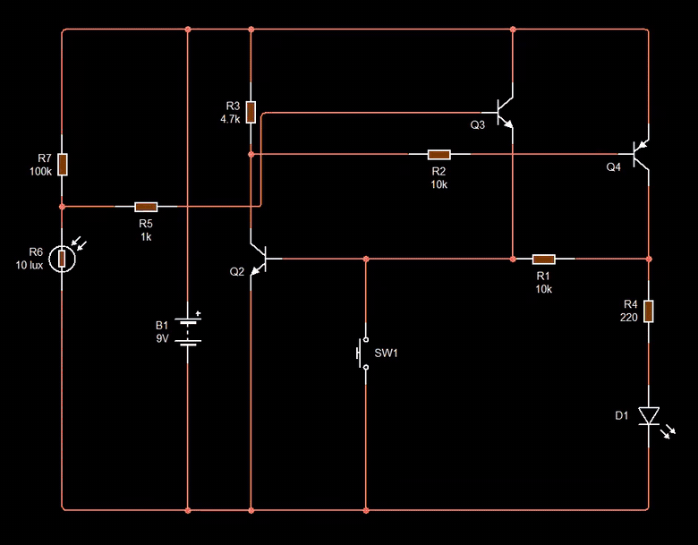

# Ep19 – Designing a Smart Circuit for a Mailbox in Front of the House

**Course:** Professional Electronic Design Course – Level 2 (Advanced Electronic Design)
**Source:** Waleed Issa Academy – [تصميم دائرة ذكية لصندوق بريد امام المنزل (Designing a smart circuit for a mailbox in front of the house)](https://www.youtube.com/watch?v=q29hRWPsdf4) (video in Arabic)
**Tool:** Circuit Wizard

> This is my own English summary of the episode, written for study purposes. All credit for the content goes to Waleed Issa Academy.

---

## Overview

You need [ep18](../ep18-transistor-latch-with-delay/) (the transistor latch) before this episode. This one has two parts:

1. **Analysing latch circuits found online.** Can we recognise a latch even when it's drawn differently, and does the same rule still apply?
2. **A design project:** a mailbox that lights an LED when a letter is dropped in, and **keeps** it lit until the owner presses a reset button.

At the end, the instructor shows that a **thyristor** (SCR) is really a latch inside one part, and explains why we still prefer transistors.

---

## 1. Recap: How to Spot a Latch

> **If the base of the first transistor is connected to the collector of the second, and the base of the second is connected to the collector of the first (directly or through a resistor), it's a latch.**

- It can be built from **NPN + NPN**, **PNP + PNP**, or **NPN + PNP**.
- Press ON once → it turns on and **stays** on.

---

## 2. Online Circuit 1 – NPN + PNP Latch with No OFF

| Part | Connection |
|---|---|
| Q_N (NPN) | base = **input**, emitter → 0 V, collector → (resistor) → Q_P base |
| Q_P (PNP) | emitter → +V (5 V or 9 V), collector → **LED → 0 V** |
| Feedback resistor | Q_P collector → Q_N base |

It follows the rule above, so it must be a latch.

### Analysis (start from the output)

- The LED is grounded, so it needs **+V on its top**. That comes from **Q_P**.
- A PNP turns on when its base is **at least 0.7 V below its emitter**. The easiest way to be sure is to pull the base to **0 V**.
- What pulls Q_P's base to 0 V? **Q_N**, when it turns on.
- What turns Q_N on? A **positive input** on its base. It doesn't have to be 5 V or 9 V: anything clearly above 0.7 V (even **1 V**) works.

So: input high → Q_N on → Q_P on → LED on.

### Why it stays on

When Q_P is on, its collector is at about +V. That voltage feeds the LED **and** goes back through the **feedback resistor** into Q_N's base. So even after the input is removed, Q_P keeps feeding Q_N and Q_N keeps Q_P on. This **feedback resistor** (مقاومة التغذية العكسية) is what makes the circuit stable in its on state.

### The problem: no OFF

Setting the input to "off" does nothing. The input is just one end of a resistor, and Q_N's base is still being fed from Q_P. **There is no way to turn it off.**

A second version from the internet is identical except the LED is replaced by a **relay coil**. That's only a different load. The OFF problem is still there.

### The fix: SET and RESET

To turn a transistor off **by force**, connect its **base to ground**:

- **Mechanical:** a push-to-make switch from Q_N's base to 0 V (as in ep18).
- **Electronic:** a third transistor that pulls Q_N's base to ground when it gets a signal.

That's why the two inputs are called **SET** (= ON) and **RESET** (= OFF).

---

## 3. Online Circuit 2 – Two Transistors Wired Directly

This one looks confusing at first, but the **collectors go to the bases**, so it's a latch.

- With two transistors of the **same type**, they're always in **opposite** states: one on, the other off.
- With **different types** (NPN + PNP), they're in the **same** state: both on or both off.

Here the switches connect the bases to **ground**. Grounding the base of one transistor turns it **off**, which lets the supply voltage reach the other transistor's base and turn it **on**, so the LED lights. The second switch grounds the other base and flips it back.

Notice that the switch labelled **SET** (ON) actually turns a transistor **off**. That's normal in a same-type latch: you turn one side on by turning the other side off.

**Where else this shape is used:**

- **Flasher:** put an LED on **each** transistor. They light opposite each other.
- Replace the two switches with **capacitors** and the circuit flips back and forth by itself (the capacitors charge and discharge). The two LEDs blink alternately. (This is the oscillator coming up in ep22.)
- Replace the switches with **transistors**, and SET/RESET can come from a microcontroller, a computer or a phone. Mechanical parts become electronic parts.

---

## 4. The Project: A Smart Mailbox

**Request:** A homeowner wants to know if anything has been put in the mailbox in front of the house **without** walking out with the key to open it.

**Requirements:**

- A small **LED** on the outside of the box **lights and stays lit** as soon as anything is put in.
- When the owner empties the box, they press a **reset (OFF)** button. The LED goes off and waits for the next letter.
- Start from the **ep18 latch** (with ON and OFF switches), and use **only transistors and basic parts, no relays**.
- **Hint:** add a **laser** and a **light-dependent resistor (LDR)**. Think about where they go.

### The idea

- Mount a **laser** on one side of the slot and the **LDR** on the other. The laser shines on the LDR all the time.
- A letter falling in **breaks the beam** for a moment. The LDR goes dark, its resistance rises, and that change becomes the **ON** signal.
- The latch then keeps the LED on even after the letter has passed and the beam is back.

So the job is: **replace the ON switch with a transistor** driven by the LDR. A transistor is a switch, so its collector and emitter go on the **same two points** where the ON switch was.

### The LDR voltage divider

```
+9 V ── R_top ──┬── LDR ── 0 V
                │
               V_A  → (base resistor) → switching transistor
```

$$
V_A = 9\ \text{V} \times \frac{R_{LDR}}{R_{top} + R_{LDR}}
$$

- **Laser on (bright):** $R_{LDR}$ is small → $V_A \approx 0$ V. In the video's simulation: **35 mV**, basically 0. The transistor stays off, like an un-pressed ON button.
- **Beam broken (dark):** $R_{LDR}$ is large → $V_A$ rises. In the simulation: about **8 V**. That turns the transistor on, like pressing ON.

8 V is too much to put straight on a base, so a **base resistor** goes between $V_A$ and the transistor.

### Choosing $R_{top}$

It depends on **your** LDR. The instructor measured his:

| Condition | $R_{LDR}$ |
|---|---|
| Laser on it | a few ohms (very low) |
| Dark | ≈ **0.5 MΩ** |

Pick a value **between** the two, so that it's much bigger than the bright resistance and much smaller than the dark resistance. He chose **100 kΩ** (10 kΩ, 100 kΩ or even MΩ can be right for other LDRs). Check:

$$
\text{dark: } V_A = 9 \times \frac{500\ \text{k}\Omega}{100\ \text{k}\Omega + 500\ \text{k}\Omega} = 7.5\ \text{V} \qquad
\text{lit: } V_A \approx 0\ \text{V}
$$

### Using a MOSFET instead

The same design works with an **N-channel MOSFET** in place of the switching transistor, since both are just switches. Differences:

- The gate doesn't need a series resistor (it draws no steady current), so $V_A$ can go straight to the gate.
- Add a **1 MΩ resistor from gate to ground** (pull-down), so the gate can't stay charged or float and keep the MOSFET stuck on. (Same idea as the gate pull-down in [ep14](../ep14-secret-code-circuit-no-programming/).)

In the video's simulation, the MOSFET version behaves the same: block the laser → LED on and stays on → only the reset button turns it off.

### Building it

- **Supply:** 9 V for the whole circuit.
- **Switching transistor:** **2N2222** in place of the ON button.
- **LDR + 100 kΩ** divider as above.
- The LDR is put inside a **black sleeve** so that light only reaches it from one direction (the laser), and room light doesn't affect it.
- A **laser pointer** is aimed into the sleeve.

**Hardware test:**

1. Laser on the LDR, power on → LED **off** ✔.
2. A piece of paper (the "letter") passes through the beam → LED **on** ✔, and **stays on** after the paper has gone ✔.
3. Owner empties the box and presses **reset** → LED **off** ✔.
4. Another letter → LED on again. Several letters in a row → it just stays on.

The LDR is only one choice of sensor. Any sensor that gives a voltage change (temperature, motion, …) can trigger the same latch.

---

## 5. A Latch Inside One Part: the Thyristor

The last circuit in the episode is an NPN + PNP pair with **each collector connected directly to the other's base**, **no resistors at all**, plus an LED, an ON switch and an OFF switch.

- **ON** gives a positive voltage to the NPN's base → NPN on → its collector pulls the PNP's base to 0 V → PNP on → the PNP feeds the NPN's base. **Latched.**
- **OFF** grounds the NPN's base → both turn off.

This exact structure is the **inside of a thyristor (SCR)**. So a thyristor on its own can act as a latch:

- **One short pulse on the gate** turns it on, and current keeps flowing through it (and the LED).
- **Grounding the gate does NOT turn it off.** That's its weakness.
- To turn it off, you have to **stop the current through it**:
  - a switch **across** the thyristor (short it for a moment so its current drops to zero), or
  - a **normally-closed** switch **in series** with it, which cuts the current when pressed.

| | Transistor latch | Thyristor latch |
|---|---|---|
| Parts | 2 transistors + resistors | 1 thyristor |
| Turn on | signal on a base | one pulse on the gate |
| Turn off | ground a base (small signal) | must cut or bypass the **load current** |
| Flexibility | high | limited |

That's why the instructor prefers transistors. But the mailbox could also be redesigned with **one thyristor** instead of two transistors (ON switch or LDR-driven transistor on the gate, OFF switch interrupting the current).

---

## Summary of Values from the Video

| Item | Value |
|---|---|
| Supply | 9 V |
| Divider top resistor | 100 kΩ |
| LDR (real) | very low (laser on) → ≈ 0.5 MΩ (dark) |
| $V_A$ in the video's sim | ≈ 35 mV (lit) → ≈ 8 V (dark) |
| Switching transistor | 2N2222 (NPN), or an N-channel MOSFET |
| MOSFET gate pull-down | 1 MΩ |

---

## My Circuit Wizard Simulation

All files are in [`media/`](./media/). The GIF plays on this page (cropped to the circuit). Click the MP4 link for the full recording. In Circuit Wizard's voltage view, **red = high voltage** and **green = near 0 V**. The light on the LDR is changed with its slider (10 lux = dark / beam blocked, 1000 lux = laser on). Times below are **MP4 times**.

📁 Circuit file: [ep19-smart-mailbox-letter-detector.cwz](./ep19-smart-mailbox-letter-detector.cwz) – 1 × 9 V battery, 2 × NPN, 1 × PNP, 1 × LDR, 1 × red LED, 220 Ω, 1 kΩ, 4.7 kΩ, 2 × 10 kΩ, 100 kΩ, 1 × push-to-make switch

This is the ep18 NPN + PNP latch (load at the bottom), **without** the delay, with the ON button replaced by an LDR-driven transistor.

| Part | Role | Connection |
|---|---|---|
| B1 | 9 V supply | |
| R7 (100 kΩ) + R6 (LDR) | light sensor divider | +9 V → R7 → **node A** → R6 → 0 V |
| R5 (1 kΩ) | base resistor | node A → Q3 base |
| Q3 (NPN) | **replaces the ON button** | collector → +9 V, emitter → **Q2 base** |
| Q2 (NPN) | pulls Q4's base low | base = latch node, collector → R3 (4.7 kΩ) → +9 V, emitter → 0 V |
| R2 (10 kΩ) | Q4 base resistor | Q2 collector → Q4 base |
| Q4 (PNP) | high-side switch for the LED | emitter → +9 V, collector → R4 + D1 |
| R4 (220 Ω) + D1 | LED (load at the bottom) | Q4 collector → 220 Ω → LED → 0 V |
| R1 (10 kΩ) | feedback | Q4 collector → Q2 base |
| SW1 | **reset (OFF)**, push-to-make | Q2 base → 0 V |

---

### Sim 1 – Laser-triggered mailbox latch



*The LDR starts dark (10 lux) so the LED lights at once. Raising the light to 1000 lux ("laser back") doesn't turn it off; only SW1 does. Then the light is lowered slowly until the LED latches again: watch the LDR's resistance in the pop-up at the moment D1 lights, and notice that pressing SW1 while the LDR is still dark does nothing.* · [MP4](media/ep19-sim-mailbox-laser-latch.mp4)

| MP4 time | Light on LDR (R6) | Action | D1 | Meaning |
|---|---|---|---|---|
| ≈ 4 s | 10 lux (10.43 MΩ) | sim starts | **on** ✔ | beam blocked → ON signal |
| ≈ 8 s | **1000 lux** (400 Ω) | light restored | **stays on** ✔ | latched, letter has passed |
| ≈ 9 s | 1000 lux | **click SW1** | **off** ✔ | owner resets |
| 9–11.4 s | 1000 → 887 lux (2.5 kΩ) | nothing | off ✔ | laser on, no letter |
| ≈ 11.5 s | **799 lux (20.42 kΩ)** | light falling | **on** ✔ | threshold crossed |
| 12.5–15.5 s | ≈ 545 lux (103.6 kΩ) | **click SW1** (≈ 13.5–14 s) | **stays on** | beam still blocked → re-triggers at once |
| ≈ 16.5 s | 1000 lux | light restored | stays on ✔ | latched |
| ≈ 18 s | 1000 lux | **click SW1** | **off** ✔ | reset works |
| 18.5–22.5 s | 1000 lux | released | **stays off** ✔ | waits for the next letter |

### Expected vs. simulated

**Divider voltage** $V_A = 9\ \text{V} \times R_6 / (100\ \text{k}\Omega + R_6)$:

| $R_6$ (from the sim) | $V_A$ (calculated) | D1 |
|---|---|---|
| 400 Ω (1000 lux) | 0.036 V | off |
| 2.5 kΩ (887 lux) | 0.22 V | off |
| 20.42 kΩ (799 lux) | 1.53 V | **on** |
| 103.6 kΩ (545 lux) | 4.58 V | on |
| 10.43 MΩ (10 lux) | 8.91 V | on |

✔ The 0.036 V (lit) and 8.91 V (dark) match the **35 mV** and **≈ 8 V** shown in the video.

**Turn-on threshold.** Q3's emitter feeds Q2's base directly, so two base-emitter junctions are in series (like a Darlington). The latch should trigger when

$$
V_A \gtrsim V_{BE3} + V_{BE2} \approx 0.7 + 0.7 = 1.4\ \text{V}
\quad\Rightarrow\quad
R_6 = \frac{R_7\, V_A}{9 - V_A} = \frac{100\ \text{k}\Omega \times 1.4}{7.6} \approx 18\ \text{k}\Omega
$$

✔ In the sim it switched between **2.5 kΩ (0.22 V, off)** and **20.42 kΩ (1.53 V, on)**, which brackets the expected ≈ 1.4 V / 18 kΩ. With the slider moving this fast I couldn't catch the exact point.

**Base drive is safe.** All of Q3's base current comes through R7, so it can't exceed about $(9 - 1.4)\ \text{V} / 100\ \text{k}\Omega \approx 76\ \mu\text{A}$. Even when SW1 grounds Q3's emitter, Q3 can only pass about $\beta \times 76\ \mu\text{A}$ (a few mA), so nothing is shorted.

**LED current** (same as ep18): $I_{LED} \approx (9 - 2 - 0.2)\ \text{V} / 220\ \Omega \approx 31\ \text{mA}$.

### What I noticed

- ✔ **The circuit really latches.** After the beam is restored (1000 lux), the LED stays on. Only SW1 clears it.
- ⚠ **Reset only works if the beam is clear.** At 545 lux, pressing SW1 didn't turn the LED off, because Q3 was still sending an ON signal into the same node SW1 grounds. When SW1 is released, the latch catches again. In a real mailbox this means: if a letter gets **stuck in the beam**, the LED can't be reset. That's actually useful, because the box isn't empty yet.
- ⚠ **Powering up in the dark turns the LED on.** At the start the LDR was at 10 lux, so the LED lit straight away. A real build should power up with the laser already on the LDR (as in the video's hardware test).
- The sensitivity depends on $R_7$. A **bigger** $R_7$ needs a **bigger** LDR resistance (darker) to trigger. For a real LDR (≈ 0.5 MΩ dark), 100 kΩ gives plenty of margin.

---

## What I Learned

- Any circuit where **each collector feeds the other's base** is a latch, however it's drawn. NPN + NPN, PNP + PNP or NPN + PNP all work.
- The **feedback resistor** from the output back to the input transistor is what keeps a latch on, and it's also why setting the input "off" can't turn it off.
- **RESET** = pull a base to ground, with a switch or with a transistor. SET/RESET can then come from any electronic signal.
- Same-type latches hold **opposite** states, mixed-type latches hold the **same** state. Two LEDs + capacitors instead of switches → a flasher.
- To make a circuit react to an event, **replace the ON switch with a transistor** placed on the same two points, and drive its base from a sensor.
- An **LDR divider** turns light into voltage. Pick the fixed resistor **between** the LDR's bright and dark values (100 kΩ here).
- A MOSFET works the same way but needs a **gate pull-down** (1 MΩ).
- A **thyristor** is a built-in latch, but it can only be turned off by cutting or bypassing its load current, so transistors are more flexible.
- My simulation latched at about $V_A \approx 1.4$–1.5 V (two $V_{BE}$ drops), i.e. $R_{LDR}$ ≈ 18–20 kΩ with 100 kΩ on top (**from my Sim 1**).
- The reset button can't clear the LED while the beam is still blocked, and the circuit turns on by itself if powered up in the dark (**from my Sim 1**).

### Next to try

- Simulate the MOSFET version (N-channel in place of Q3, 1 MΩ gate pull-down) and compare the trigger point with the BJT version.
- Find the exact trigger by moving the LDR slider slowly, and add a voltmeter on node A.
- Add the ep18 delay (100 kΩ + 470 µF) and see whether a falling letter (a short dark pulse) still triggers it. It probably won't, which shows why the mailbox needs **no** delay.
- Try $R_7$ = 10 kΩ and 1 MΩ to see how the sensitivity changes.
- Build the thyristor version: one SCR with the LDR transistor on the gate and an NC reset switch in series.
